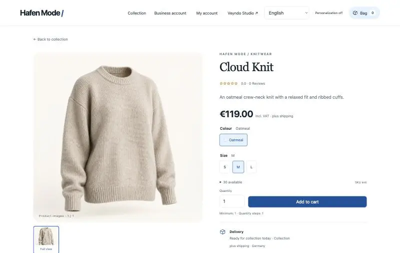
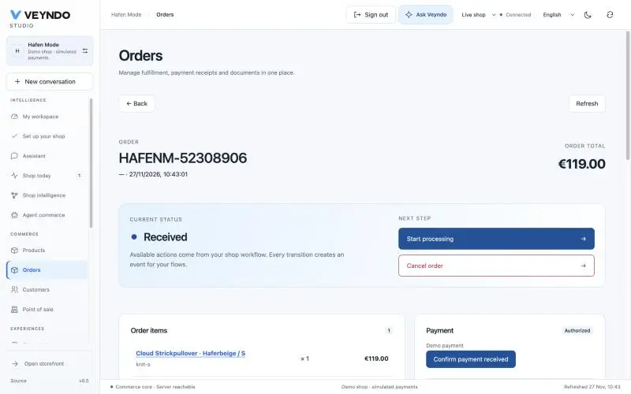
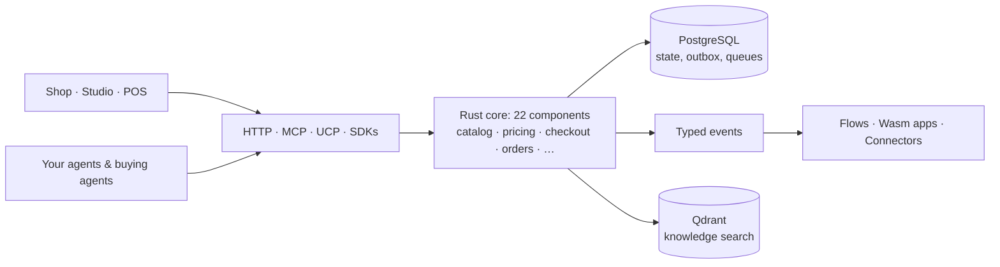

<p align="center">
  
</p>

<div align="center">

# Veyndo Commerce

**The AI-native commerce platform, built in Rust.**<br>
Shoppers, merchants and their agents work on the same functions.<br>
One core decides price, stock and order.

[](https://github.com/veyndo/veyndo/actions/workflows/verify.yml)
[](https://www.veyndo.ai/docs/)
[](docs/status.md)
[](LICENSE)

[**Create a shop**](https://start.veyndo.ai/start) · [Website](https://www.veyndo.ai/) · [Start here](docs/start-here.md) · [Handbook](https://www.veyndo.ai/docs/) · [Watch the tour](docs/video-tours.md) · [Deutsch](docs/platform-overview.md)

</div>

## Shops were built for clicks. Veyndo is built for intent.

Customers no longer only click through categories. They ask an assistant for a gift
under 80 euros, and soon their own agent will compare and buy for them. Merchants
no longer want to fill in forms. They want to say *"lower the price of slow movers,
but protect my margin"* and see what would happen before it happens.

A chat window next to an old shop system can't do that. The platform itself has to be
built for agents: every function typed, permissioned and auditable, every change
testable before it goes live, and every number exact. That is Veyndo.

> **The shop that changes itself and demonstrably breaks nothing.**
> AI proposes. A private twin of your shop tries it with simulated customers and
> attackers. You approve. The Rust core decides price, stock and order, with rules
> that are checked by machine proofs.

<table>
<tr>
<td width="50%"><a href="docs/ui-experience.md"></a></td>
<td width="50%"><a href="docs/admin-workflows.md"></a></td>
</tr>
<tr>
<td align="center"><sub>The storefront: your brand, real variants, live stock and delivery</sub></td>
<td align="center"><sub>Studio: every order transition is an event your flows and agents can use</sub></td>
</tr>
</table>

## Why Veyndo

| | |
| --- | --- |
| 🤖 **Agents are first-class** | 212 MCP tools, UCP cart transfer and signed offers. Agents buy, sell and run the shop through the real catalog, checkout and permissions, with budgets, approvals and a stop switch. [Agent purchase](docs/agent-purchase.md) · [Limits](docs/agent-authority-controls.md) |
| 🧪 **Change without fear** | A private shop twin with fictional customers and scripted attackers tries every change first; releases publish exactly what you reviewed. [Shop twin](docs/shop-twin.md) · [Simulator](docs/customer-scenarios.md) |
| 🧩 **Apps that are products** | Apps bring their own data, screens, settings, jobs and actions as sandboxed Wasm with declared capabilities. Describe one, edit it visually or code it. [App platform](docs/app-platform.md) · [Build five apps](docs/app-tutorials/README.md) |
| ⚙️ **Automation you can read** | Flows connect events, conditions and actions; rule drafts are compared against recorded orders before they go live. [Automation](docs/automation.md) |
| 🦀 **One core, 22 components** | Rust components with typed ports, versioned event contracts and OpenAPI contracts, plus generated TypeScript, Python and Rust SDKs. [Architecture](docs/architecture.md) · [SDKs](docs/sdks.md) |
| 🔒 **Trust you can check** | Forced row-level security per shop, Lean-checked business rules for stock, order status and rounding, exact decimal money, and an upgrade test for every release. [Security](docs/security.md) · [Proofs](docs/formal-verification.md) |

## A shop that improves itself, safely

Eight capabilities work together so that change becomes routine instead of risk:

| | Capability | What it means for you |
| --- | --- | --- |
| 1 | [**Shop twin**](docs/shop-twin.md) | Bring your catalog from Shopware, Shopify, WooCommerce or CSV into a private copy that behaves like your shop, without migrating first. |
| 2 | [**Test customers that attack**](docs/customer-scenarios.md#attack-test) | Fictional shoppers buy in the twin; scripted attackers try forged totals, stale carts, impossible quantities and replayed orders. |
| 3 | [**Autopilot with a daily limit**](docs/knowledge-workspace.md#autopilot-levels-and-the-daily-limit) | Per area, an agent either suggests or acts within a budget; every change can be taken back. |
| 4 | [**Experiments that run themselves**](docs/knowledge-workspace.md#experiments-that-run-themselves) | Suggested from your own payments, started once, read out and decided automatically. |
| 5 | [**Signed offers for buying agents**](docs/agentic-commerce.md#signed-offers) | A buying agent gets a quote it can verify offline; checkout confirms exactly that cart. |
| 6 | [**Reorder between shops**](docs/trade-network.md) | At the reorder point your shop fetches a signed offer from your supplier's shop and checks it against your ceiling. |
| 7 | [**Proof coverage you can read**](docs/proof-coverage.md) | A generated page lists every machine-proved rule, its callers and what is not proved yet. |
| 8 | [**Sovereign AI**](docs/sovereign-ai.md) | One switch keeps every model request on models you host yourself. |

## Built for agents, from the first line

Every capability is one typed operation with its permission, so a person in Studio,
a Flow, an app and an agent all call the same thing, and the core checks the same
rules every time. Connect your own agent or frontend in a few lines:

```js
import { createClient } from '@veyndo/sdk';

const veyndo = createClient({
  baseUrl: 'https://app.veyndo.ai',
  shop: 'your-shop',
  token: () => process.env.VEYNDO_TOKEN, // a scoped integration key
});
await veyndo.initialize();
const tools = await veyndo.tools();                       // the shop's MCP tools
const lamps = await veyndo.tool('catalog.search', { query: 'lamp' });
```

Model output is treated as untrusted input. Agents act with the key's permissions,
within budgets and approval levels, and every action lands in the audit log.
[JavaScript SDK](https://github.com/veyndo/sdk) · [MCP workshop](docs/agent-workshop.md) ·
[Agentic commerce](docs/agentic-commerce.md) · [Agent purchase](docs/agent-purchase.md)

## How it fits together



Use the complete shop, or bring your own frontend through the SDKs. Every surface
calls the same operations, so a price an agent sees is the price the checkout charges.
[Illustrated walkthrough](https://www.veyndo.ai/docs/one-shop-components.html) ·
[Components](docs/commerce-components.md) · [Runtime](docs/production-architecture.md).

**The 22 components:** core, identity, shop, catalog, inventory, pricing, shipping,
checkout, customers, orders, payments, marketing, b2b, pos, apps, automation,
inference, intelligence, studio, protocols, host and connectors. Each owns its tables and
declares its dependencies; the commerce components build and test on their own.

## Engineering you can verify

| | |
| --- | --- |
| **Exact money** | Prices are exact decimals; rounding and totals follow machine-proved rules. [Currencies](docs/currencies.md) |
| **Checked SQL** | SQL queries are checked at compile time against the migrated schema; each shop is isolated by forced row-level security. [Database scope](docs/authenticated-database-scope.md) |
| **Machine proofs** | Lean proofs for stock, order status, rounding and totals, tied to the Rust code that uses them. [Formal verification](docs/formal-verification.md) |
| **Safe releases** | Forward migrations in expand/contract style; every release is tested by upgrading the previous one with real orders while both versions serve. [Migrations](docs/rust-services.md#forward-migrations) |
| **Stable contracts** | Versioned event schemas and per-component OpenAPI contracts with a compatibility gate; semantic versions per component. [SDKs](docs/sdks.md) |
| **Measured, not claimed** | Benchmarks with raw data and a status page that separates what is verified from what is not. [Benchmarks](docs/benchmarks.md) · [Testing](docs/testing.md) |

## What you can do

- **Run a full shop:** catalog, variants, prices, taxes, shipping, payments, B2B, POS,
  marketplaces and EDI, in every language and currency you enable.
  [Setup](docs/start-here.md) · [International](docs/international-commerce.md) · [B2B](docs/b2b-commerce.md) · [POS](docs/pos.md) · [Marketplaces](docs/marketplaces.md)
- **Work with an agent in Studio:** it builds working views, prepares changes in a
  private sandbox and applies only what you approve. [Agentic workspace](docs/agentic-workspace.md)
- **Let shoppers shop by intent:** a gift, a budget or a comparison becomes real product
  cards, native variants and a normal checkout. [Shopping experiences](docs/ui-experience.md)
- **Design visually:** shop pages and app placements on one zoomable canvas, with drafts
  and AI proposals side by side. [Visual design](docs/personal-workspace-and-shop-design.md)
- **Bring your shop:** import from your current platform into a private preview.
  [Migration Assistant](docs/agentic-migration.md)
- **Host it yourself:** one Rust binary, PostgreSQL and Qdrant; `veyndo --provision`
  sets up roles and database authority. [Deployment](docs/deployment.md)

## Try it

**Hosted:** [create a shop](https://start.veyndo.ai/start) or [a Storyfront Experience](https://experience.veyndo.ai/).

**Container tour** (Git, Docker Compose and OpenSSL; no Rust or Node build):

```sh
git clone --depth 1 https://github.com/veyndo/veyndo.git
cd veyndo && ./scripts/try.sh
```

Open `http://127.0.0.1:8788/`, place a simulated order, inspect it in Studio and
publish a reviewed change. [Complete tour](docs/first-tour.md)

**From source:** Rust 1.96+, Node.js 22+, Docker Compose. Run `./scripts/dev.sh` and open
`http://127.0.0.1:8787/#merchant`. [Quickstart](docs/quickstart.md) · [Source map](docs/source-map.md) · [Testing](docs/testing.md)

<!-- roadmap:start -->
**Roadmap:** 8 of 8 stages work today. [See what comes next](docs/roadmap.md).
<!-- roadmap:end -->

## Status and boundaries

Veyndo is a working prototype running on its own hosted platform, not yet established
production infrastructure. Live payment providers, each OAuth provider, disaster
recovery and capacity need separate evidence; Lean proofs cover named pure rules, not
the whole system. [The current status](docs/status.md) records what is verified.

[Contribute](CONTRIBUTING.md) · [First contributions](docs/early-contributors.md) ·
[Discussions](https://github.com/veyndo/veyndo/discussions) · [Report an issue](https://github.com/veyndo/veyndo/issues/new/choose) · [Changelog](CHANGELOG.md)

## License

Source-available under the **[Veyndo Sustainable Use License 1.0](LICENSE)**.
Run and customize your own stores, brands and apps. Competing shop platforms,
white-labeling and managed commerce/SaaS for independent merchants require a
separate written commercial license. This is not an OSI-approved open-source
license. Earlier MIT versions retain their rights; third-party terms remain intact.
[License examples](docs/licensing.md) · [Third-party notices](THIRD_PARTY.md).
