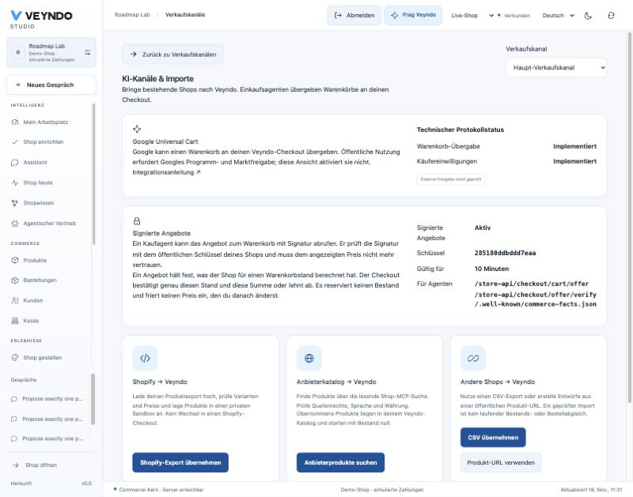

# Shopping agents, cart transfer and shop imports

A shopping agent can search your catalog, fill a cart and hand the buyer over
to your checkout. You keep the checkout, prices, stock, order, permissions and
the decision to publish. Veyndo does not export into Shopify and does not buy
at a supplier's checkout.

## Which path do you need?

| You want | Use | Section |
| --- | --- | --- |
| An agent to search, quote and order through tool calls | MCP tools of your shop | [Let an agent buy](agent-purchase.md) |
| A platform to hand over a filled cart to your checkout | UCP Cart Transfer | [UCP Cart Transfer](#ucp-cart-transfer) |
| A platform to pass the buyer's consent choices | UCP buyer consent | [Explicit buyer consent](#explicit-buyer-consent) |
| An agent inside the shopper's browser to use your storefront | WebMCP tools | [Browser agents](#browser-agents-share-the-actual-cart-commands) |
| Products from another shop or a supplier in your catalog | Reviewed imports | [Merchant entry](#merchant-entry) |

All paths end in the same native cart and checkout. The
[current status](status.md) and the
[18 October public acceptance](evidence/agentic-commerce-hosted-2026-10-18.md)
record which of them ran on the hosted shop.

## Merchant entry

Open **Sales channels → AI channels & imports** and select a sales channel. The
screen shows whether Cart Transfer and buyer consent are supported for that
channel, which payment modes are configured and where the external onboarding
instructions are.

Technical support is not an approval by Google. The screen reports external
approval as unverified. Reading readiness needs `catalog.read`. Importing
products also needs `catalog.write` and access to a private environment.
Changing the channel never grants a right.

### Import products

1. Choose a source from the table below.
2. Review and edit each draft.
3. Select a private sandbox and approve creation.
4. Set stock and fulfilment, then publish the changes you selected.

| Source | What happens | Boundary |
| --- | --- | --- |
| Shopify export | Upload the product CSV; priced variant rows become editable Veyndo drafts, with parent title, description and image inheritance | Up to 50 variants per review. Variants become separate native products. CSV prices are interpreted in the selected Veyndo base currency; verify them explicitly. No invented exchange rate, supplier stock or continuous sync |
| Supplier catalogue | Search the public Shop MCP catalogue, optionally limit by shop domain | Read-only `search_catalog`; up to 10 selected featured variants. Supplier currency must match Veyndo’s base currency. No supplier login, cart, wallet or purchase calls |
| Generic CSV | Upload the native name/description/price/product-number/image format | Existing deterministic import, no model required |
| Shop URL / product description | Use the existing bounded AI preparation | Requires configured inference and `assistant.use`; external text is untrusted |

Imported products start with **zero stock**. Before you publish, check that you
may use the supplier's text and images and sell the products. The recorded
source tells you where a product came from. It is not a certificate of
authenticity and not a permission to resell. The importer does not synchronise
supplier stock, orders or prices in the background.

The native save records revision, history, events and an idempotency digest, so
repeating an approval does not create duplicates.

Provider-specific parsers and network code live in
[`extensions/apps/catalog-import/`](../extensions/apps/catalog-import/README.md).
They use the existing shared egress admission and pinned public HTTPS client.
Private DNS, credentials in URLs, redirects, oversize responses, unsupported
currency and unsuccessful responses fail before a draft is accepted.
No per-app or per-shop database table is created.

## UCP Cart Transfer

A platform sends a cart, your shop recalculates it and returns a link where the
buyer finishes in your normal checkout.

1. The platform discovers the shop at `/.well-known/ucp`.
2. It sends `POST /ucp/v1/carts` with native product IDs in
   `line_items[].item.id`, positive integer quantities and optionally a
   supported currency and buyer.
3. The shop recalculates through the native channel, catalogue, stock, tax and
   price owners. Prices or return origins supplied by the caller have no
   authority.
4. The response contains the native totals, an expiry and a canonical
   `continue_url`.
5. The buyer opens that link and completes the order in the existing checkout
   and payment lifecycle.

What protects the handoff:

- The continuation uses the existing ten-minute, single-use handoff in a URL
  **fragment**, not a bearer in the query string.
- Consuming it rotates the cart capability. Consumption by another tenant and
  replay both fail.
- The continuation pins the cart's content language, so native names and
  shipping and payment labels survive the handoff.
- Repeated order submission keeps the native idempotency contract.

A `UCP-Agent` public HTTPS profile must intersect the requested base
capability. A cart-only platform does not need to claim checkout. Profiles
never grant merchant or customer authority. The separately versioned
[B2B negotiation extension](b2b-ucp-negotiation.md) stays optional and has its
own gate.

Google's merchant enrolment and regional availability still apply. Shipping
this endpoint does not mean Veyndo has been admitted to Google surfaces. See
the [Google Cart overview](https://developers.google.com/merchant/ucp/guides/overview/cart-overview)
and [Merchant Center guidance](https://developers.google.com/merchant/ucp/guides/tools/merchant-center/overview).

## Signed offers

A buying agent does not have to trust the price it is shown. It can ask the shop
for the cart's quote **with a signature** and check that signature with the
shop's public key, without calling the shop again.



*Local Studio, synthetic shop, 18 November 2026.*

**For merchants.** Open **Sales channels → AI channels & imports**. The **Signed
offers** card shows whether offers are signed on this installation, the key
identifier and how long an offer is valid. There is nothing to switch on per
shop; signing needs the operator's signing key (`FACT_SIGNING_SEED` or the
platform secret).

**For agents.** With the cart token in `sw-context-token`:

1. `GET /store-api/checkout/cart/offer` (MCP tool `cart.offer`) returns
   `payload`, `payloadBase64`, `signature`, `algorithm` (`Ed25519`), `keyId` and
   `verificationKeys`.
2. Fetch the public key once from `/.well-known/commerce-facts.json` and verify
   `signature` over the decoded bytes of `payloadBase64`.
3. Read the signed fields: shop, sales channel, cart revision, currency, exact
   total in minor units, each line with quantity and prices, the selected
   country, shipping and payment method, `issuedAt` and `expiresAt` (ten
   minutes).
4. Optional: `POST /store-api/checkout/offer/verify` (MCP tool `offer.verify`)
   with `payloadBase64` and `signature` answers whether the offer is authentic,
   expired, and whether checkout would still confirm it for the cart you hold.

Try it against a running shop:

```sh
python3 scripts/demo/signed_offer.py http://127.0.0.1:8787 atelier lamp
```

**What an offer is and is not.** It states what the shop calculated for one cart
revision at one moment. Checkout confirms exactly that revision and total, or
refuses, and the agent asks for a new offer. It does not reserve stock and it
does not freeze a price the merchant changes afterwards: after such a change the
old offer is still authentic but no longer honoured. It contains no buyer data
and never the cart token. AP2 payment mandates are not part of it.

## Explicit buyer consent

A platform can pass the buyer's consent choices together with the cart. The
optional extension `dev.ucp.shopping.buyer_consent` accepts four registered
purposes: analytics, preferences, marketing and sale/sharing.

| Rule | Behavior |
| --- | --- |
| Who decides | Requests supply explicit `source: "platform"` boolean decisions, with the registered email and SMS marketing segments. |
| Who describes | Descriptions and policy metadata belong to the server. Unknown purposes or segments and asserted business grants are rejected. |
| Sale/sharing | Always disabled, because Veyndo has no corresponding processing purpose. |
| Omitting consent | Preserves the earlier choice. Replacing an explicit purpose replaces its segment choices. |
| Clearing the buyer | Revokes native optional processing. |
| Merchant policy | Can withhold a purpose even when a platform requests it. |
| Completed orders | Keep an immutable policy and consent snapshot. A later revocation governs future processing and does not rewrite historical orders. |

Details that matter when you integrate:

- A PUT without a buyer replaces earlier buyer contact fields and keeps explicit
  consent choices. Required contacts that are missing block completion, and
  required marketing contact information must be present before completion.
- An unrelated update cannot revive a withdrawn or expired native grant.
- Consent and cart mutation commit atomically through the native cart and
  privacy owners.
- Consent is disabled unless a compatible platform profile selects it. Native
  clients can pre-negotiate with `x-veyndo-ucp-consent-version: 2026-08-25`.
  The legacy B2B version header alone never enables consent.
- An unnegotiated caller receives no consent extension and cannot submit
  choices under it. No implicit tracking grant is created.

See the [UCP buyer-consent schema](https://ucp.dev/2026-08-25/schemas/shopping/buyer_consent.json)
and Veyndo’s [legal/privacy owner](european-operation.md).

## Browser agents share the actual cart commands

An agent running in the shopper's browser can use the storefront through
WebMCP. The tools and the storefront's own buttons share the same native cart
commands and serialized current revisions. Supported browsers can discover:

- `veyndo_search_catalog`: bounded public product search in the current shop/channel.
- `veyndo_get_cart`: product IDs/names, quantities and totals; no bearer or buyer details.
- `veyndo_add_product`: add a selected product, creating a cart when necessary and preserving existing items. Concurrent additions share the native revision queue; cancellation stops subsequent writes.
- `veyndo_update_cart`: replace items, using native validation and recalculation.
- `veyndo_review_checkout`: open checkout for the buyer to review and decide.

There is **no automatic order, charge or refund tool**. Registration uses
`document.modelContext` only when available and is removed on teardown; old shop
contexts cannot save into a newly selected shop. Unsupported experimental APIs
leave ordinary shopping available. These tools are not exposed to other origins.
See [Chrome’s current imperative API](https://developer.chrome.com/docs/ai/webmcp/imperative-api).

The registered add action validates IDs and quantities before creating a cart.
Search and cart results mark merchant content as untrusted. Twelve targeted command
and hook tests cover registration, empty and completed carts, concurrent changes,
cancellation, shop switching, private previews and ordinary shopping without the
experimental API. All five tools were also discovered and called in the in-app browser against a
local native Rust/PostgreSQL shop: search, add, quantity change, cart read and
checkout review. Negative quantities and unknown products were rejected. See the
[actual browser evidence](evidence/connected-commerce-2026-10-30.md#browser-agent-cart-entry).
Public deployment remains tracked in the
[connected-commerce checklist](plans/2026-10-30-connected-commerce.md#6-webmcp-completion).

## Agent proposals and app diagnostics

Shop design still uses the app-owned, versioned page model and actual storefront
renderer. Each agent proposal now shows added/removed/repositioned blocks, changed
theme fields and form/app counts, with desktop/mobile preview entry points. These
are structural differences, not a claim that visual quality, accessibility or
app behavior was automatically accepted. Test forms, links and app components in
the sandbox before selected publication.

**App Studio → Versions & releases** shows declared placements, required installed
settings, models, explicitly enabled agent tools and business-example counts.
Each opens its existing editor. The shared assistant can prepare concrete success,
denial, retry and rollback tests. Counts do not claim that a test ran or a required
secret was entered; installed secrets retain their existing live-only encrypted owner.


## Verification and external gates

[Local acceptance and scope](evidence/agentic-commerce-local-2026-10-18.md).

The registered `agentic_commerce`, `checkout_handoff`, `b2b_ucp`, `catalog_management`
and `legal_privacy` suites exercise real Rust/HTTP/PostgreSQL paths. Frontend tests
cover channel rights, deterministic imports, current-revision commands, stale-shop
rejection, WebMCP lifecycle and real preview/editor handoffs. The private Shopware
Payments adapter can run with a local synthetic PSP: UCP transfer → native checkout
→ private provider → confirmed capture → partial refund and restart replay. This is
simulated money, never proof of real PSP settlement or live wallet acceptance.

Muse/Link partnerships, Google account admission, real PSP settlement, native
WebMCP availability in a specific browser and continuous authenticated supplier
synchronisation remain separate external capabilities. Do not label them connected
from a successful local import, protocol discovery or fixture.
