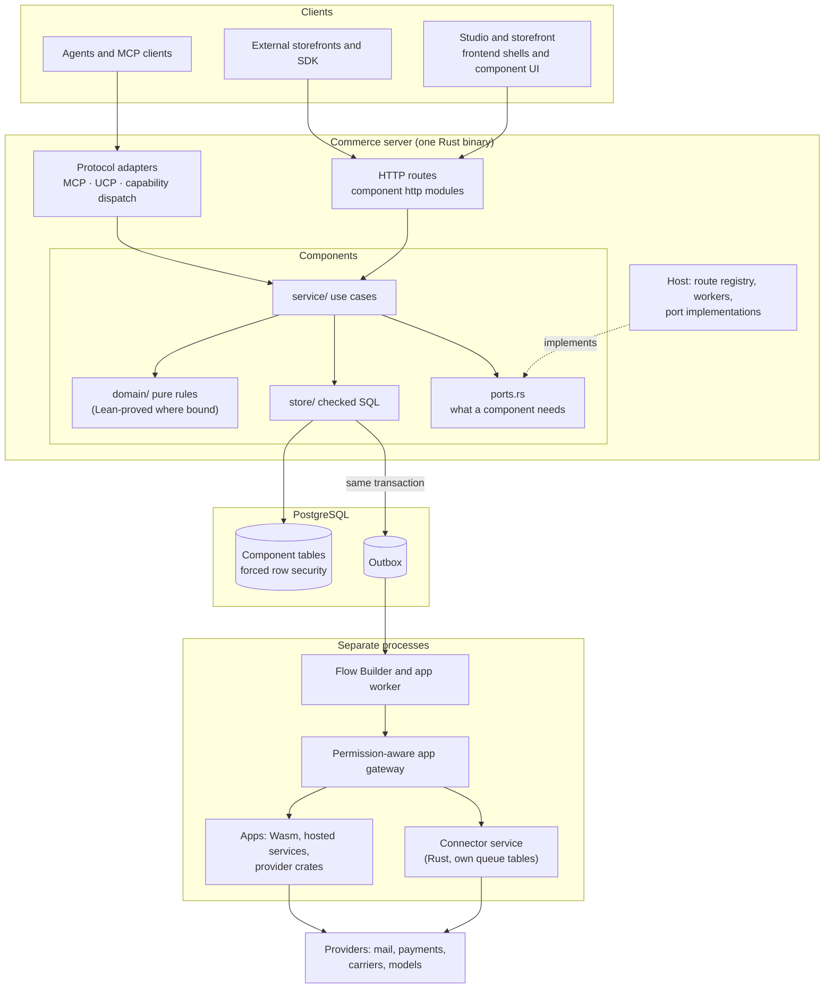

# Component architecture

Veyndo is one Rust commerce server built from 22 components. Each component owns
its data, its rules, its schema and its screens; the server binary composes them,
and the frontend, the HTTP API, MCP and UCP are clients of the same component
operations. This page describes the layout as it exists in the component-architecture
release candidate. The [release notes](current-release.md) list what changed, the
[runtime guide](production-architecture.md) follows one request through it and the
[source map](source-map.md) names the owner of every area.

`components.json` is the checked version of everything below. `scripts/components.py`
(part of the required structure check) refuses a source file or table without an owner,
a dependency that is not declared, a dependency cycle and a growing ratchet. The
generated [dependency report](component-dependencies.md) and
[module inventory](module-inventory.md) hold the current numbers.

## How the parts connect



A purchase runs inside one component transaction: checkout prices the cart through
pricing, reserves stock through inventory and writes the order and its `order.placed`
event to the outbox in the same commit. Everything that talks to the outside world
starts from a committed event: the Flow Builder picks it up, the app gateway admits
the call with the app's declared permissions and the connector service or an app
delivers it. Order email follows exactly that path (checkout → outbox → Flow Builder →
app gateway → connector → PostgreSQL delivery queue → provider). No component sends
mail, calls a payment provider or a model from inside a checkout lock.

## The 22 components

| Component | Owns | Source |
| --- | --- | --- |
| core | Errors, request context, database scope and row security, outbox, admission, caches, the verified kernel | `components/core`, `crates/kernel`, `crates/runtime` |
| identity | Merchant accounts, memberships, sessions, MFA, roles, integration keys, route policy | `components/identity` |
| shop | Shop configuration, domains, legal texts, settings writes, the operator control plane | `components/shop` |
| catalog | Products, categories, media, reviews, translations, catalogue reads, product files | `components/catalog` |
| inventory | Stock, reservations and their release, supply and supplier links | `components/inventory` |
| pricing | Money, price calculation, discounts, currencies, taxes, customer groups, price jobs | `components/pricing` |
| shipping | Delivery methods, destinations, delivery splits, carrier booking | `components/shipping` |
| checkout | Cart, quote, checkout transaction and order placement | `components/checkout` |
| customers | Customer accounts, sessions, addresses, the merchant customer directory | `components/customers` |
| orders | Order state machine, fulfilment, receipts, documents, merchant order work | `components/orders` |
| payments | Provider-independent payment ledger, captures, refunds, provider workers | `components/payments` |
| marketing | Rules, coupons, promotions, flows, sales channels | `components/marketing` |
| b2b | Companies, budgets, approvals, quotes, procurement | `components/b2b` |
| pos | Point-of-sale register adapters | `components/pos` |
| apps | App packages, managed data, UI surfaces, Wasm extensions, the app builder | `components/apps`, `crates/apps` |
| automation | Deterministic rule evaluation and flow graphs | `crates/automation` (vendored), `crates/flow-graph` |
| inference | Model provider adapters, inference budgets, prompt provenance, image generation; no commerce write capability | `crates/cognition` |
| intelligence | Shop memory, knowledge retrieval, agents, proposals, catalogue intake | `components/intelligence` |
| studio | Merchant overview, reports, private staging shops, history, manual orders | `components/studio` |
| protocols | MCP, UCP and the shared capability dispatch: adapters without business rules | `src/mcp`, `src/ucp`, `src/capabilities` |
| host | Process entry, route registry, worker roles, schema setup, port implementations, command-line tools | `src/` (the rest), `crates/port-contracts` |
| connectors | Standard provider services and their delivery queue in a separate binary | `extensions/services/connectors`, `extensions/services/connector-runtime`, `extensions/apps/<app>` |

The 151 tables each belong to exactly one component. `connectors` owns six tables and
runs as its own process; `shipping`, `pos`, `automation`, `inference` and `protocols`
own no table.

## Inside a component

```text
components/<name>/
  Cargo.toml          the crate veyndo-<name>
  src/
    lib.rs            the public interface, nothing else
    types/            ids, DTOs and enums (serde)
    domain/           pure rules without I/O; the part the Lean proofs bind
    store/            the only place with SQL (checked query macros)
    service/          use cases: transaction, rules, events
    http/             thin route handlers over the services
    ports.rs          traits for what the component needs from others
  migrations/         0001-baseline.sql: this component's tables only
  tests/              properties, domain mutants, port test adapters
  ui/admin/<area>/    Studio screens of this component
  ui/storefront/<area>/ storefront screens of this component
```

Not every component needs every folder: `core` has no `domain/` yet, `shipping` owns no
table and therefore no baseline, `orders` has no separate `service/` and `inventory` has no
UI. A component crate has no `use super::*` or `use crate::*` imports, and its files have no
length limit; Clippy limits function length instead (`clippy.toml`).

## The dependency rule and ports

A component depends on `core` and on the public interface of the components it lists in
`uses`. Cargo refuses a crate cycle, and `scripts/components.py` refuses a mutual pair,
including pairs that would only appear through server files; there are none left.

When a component needs something from a component above it, or from the server, it
declares a trait in its `ports.rs` and the host implements it. Examples:
`veyndo_pricing::ports::ShopSettings` (settings and revision for a shop and channel),
`veyndo_shop::ports::SettingsGuards`, `veyndo_payments::ports::Gateway`,
`veyndo_customers::ports::Purchases`, `veyndo_intelligence::ports::PublicEgress` and
`veyndo_studio::ports::ReleaseHost`. Sixteen components declare 47 port traits.

A component reaches another component's table only through that component's store
functions or a port. The 61 accesses that remain are listed in `foreign_tables` of
`components.json`, each with a written reason (for example: core's retention job selects
unreferenced outbox events in the same locked statement that deletes them). The check
refuses an access without a reason.

Four counters in `components.json` only fall: glob imports, untyped JSON field accesses,
SQL outside a `store/` folder and runtime SQL. Outside the vendored `crates/automation`
they stand at zero glob imports, four untyped accesses (marketing) and no SQL outside a
store.

## Server and protocol adapters

The server binary (`src/main.rs`, component `host`) declares modules and `main`. It builds
the router from the component routes, starts the worker roles, sets up the schema and
implements the ports. `App` only composes component-owned state (`veyndo_core::State`,
inference, the app runtime and identity state). MCP, UCP and the capability dispatch
(component `protocols`) translate protocol inputs to the same component operations the
HTTP routes call; they do not own a price, stock or order rule.

Moving the last composition code out of `src/` is still open: the server keeps provisioning,
identity resolution in the middleware and the host side of the app platform (plan item 5.1).

## Frontend

`frontend/` builds one tree. `frontend/src/` holds the entry, the Studio and storefront
shells, the operator console, shared building blocks and `kit/` (design tokens, UI parts,
the generated API client and the query layer). Every screen lives with its component in
`components/<name>/ui/{admin,storefront}/<area>`; thirteen components have screens.

- Every request path is typed `ApiPath`, derived from the generated route catalogue, so a
  path the server does not mount does not compile.
- The architecture check refuses a component UI import against the `components.json`
  dependency direction. The order page shows payment commands through the first-party
  slot `admin.order.payment` instead of importing payment code.
- Stylesheets use design tokens only; the check refuses colour literals.

See [frontend/README.md](../frontend/README.md) and the [kit](../frontend/src/kit/README.md).

## Data, queries and the schema

PostgreSQL holds all commerce state, connector configuration and queues. Every tenant
table forces row security; the runtime login is a non-owner, `NOBYPASSRLS` role
([tenant isolation](tenant-isolation.md)). Qdrant holds knowledge vectors only.

- **Checked queries.** Store functions use `sqlx::query!`/`query_as!`. The 1,267 queries are
  checked at compile time against the committed `.sqlx` cache (`SQLX_OFFLINE`);
  `scripts/sqlx_cache.py --write` regenerates it from the baselines and the `sql_prepare`
  suite fails on drift. 24 dynamic queries remain (`QueryBuilder` in intelligence, studio,
  apps, core and catalog); every other static statement is also prepared against the
  schema by `scripts/sql_prepare.py`.
- **Typed JSON.** Stored documents and request bodies are read through typed views
  (`veyndo_core::document::{view, lenient, Raw, merge}`); `scripts/testing/typed_inputs.py`
  refuses a new untyped reader.
- **One baseline per component.** `components/core/migrations/0000-foundation.sql` holds the
  extensions, the `veyndo_authority` schema and the shared functions; each component's
  `migrations/0001-baseline.sql` creates only its own tables. `src/migrations/schema.rs` lists
  the files by number, then in the global order: core first, then by `uses`.
- **Forward migrations upgrade production.** Since the 27 November go-live every schema
  change is a numbered file (`0002-…`) in the owning component, checksummed in the ledger
  and written expand/contract so the previous release keeps serving. Databases of the
  pre-baseline incremental release are still refused. Demo data lives in `fixtures/demo/`.

The `schema_baseline` suite proves that a fresh installation equals the normalized schema
and starting rows of "baselines + all forward migrations" (`fixtures/schema/reference.sql`);
`schema_upgrade` proves that the previous release's database reaches the same schema with
its data intact. Details: [Rust services](rust-services.md#forward-migrations).

## Events

Each component writes its events to the PostgreSQL outbox in the same transaction as
the change. Four lanes consume them, each with its own checkpoint: `flows` (Flow
Builder jobs), `apps` (leased app deliveries), `cognition` (order observations) and
`audit`. Connector providers are reached from those lanes through the app gateway.

Events are a versioned contract:

- **Typed payloads.** Every event a component publishes is a struct declared with
  `veyndo_core::event!` in the producer's `types::events` module. The macro derives
  the serde shape and the JSON Schema from one field list. Producers publish only
  through `veyndo_core::events::emit`, `emit_as` or `emit_id_as`, which also refuse a
  kind the type does not declare. Each producer module has a test showing that the
  stored JSON equals what the code wrote before the types existed.
- **Registry.** `src/events.rs` collects the payload types of all components and derives
  each kind's consumers from their own sources: the Flow catalogue, the cognition lane
  and the bundled app manifests. It renders one schema per kind and version into
  [`contracts/events/`](../contracts/events/index.json) (`<kind>.v<N>.json`). A kind
  published by several producers gets one merged schema: the union of fields, the
  intersection of required fields and an `anyOf` of the producer variants. App-defined
  events (`app.{app}.{event}`) and the events of vendored app storage are listed as
  such in `index.json`. `veyndo --event-contracts` prints the files, and a unit test
  fails when the checked-in files drift.
- **Compatibility.** `scripts/event_contracts.py` records every published version in
  `contracts/events/published.json`. It fails on a removed or renamed field, a type
  change, a newly required field or a dropped guarantee, unless a new version is
  published next to the frozen one. A version 2 or later payload carries
  `schemaVersion`. New optional fields are compatible. The same check refuses outbox
  writes that bypass the typed functions. It runs in the quick `verify` job and as the
  tooling suite `event_contracts`.

The [read-model plan](plans/2026-11-27-read-models.md) builds on these contracts to
replace the remaining cross-component table reads.

## Connector service and apps

The connector binary (`src/bin/connectors.rs`) is process entry only. The service crate
`extensions/services/connectors` composes the shared runtime
(`extensions/services/connector-runtime`: encrypted store, queue, leases, pinned egress,
OAuth) and one `veyndo-provider-<app>` crate per bundled provider in `extensions/apps/<app>/`.
It is reached only through the app gateway, keeps its own tables in its own baseline and
contains no Python. Apps run as bounded Wasm extensions, hosted services or provider crates
behind declared permissions. Payments and Storyfront implementations stay in their own
repositories. See [connectors](connector-component.md) and [app platform](app-platform.md).

## Tests

| Test set | What it shows |
| --- | --- |
| Domain unit tests | Each of the 216 public `domain/` functions is exercised in its own file |
| Property tests | 37 `proptest` properties for money, stock, discounts and state machines in pricing, inventory, orders, payments, checkout and marketing |
| Store isolation | `store_isolation`: store functions of 15 components and every one of 135 tenant tables under a non-owner `NOBYPASSRLS` login; a second shop sees and changes nothing |
| Port contracts | `crates/port-contracts`: one contract set per port, run against the test adapter and the server's real implementation (four ports so far) |
| HTTP and MCP contracts | `schema_contracts`: a valid and an invalid case for 350 routes and 212 MCP tools, generated from the route catalogue and the operation contracts |
| Mutation testing | `scripts/testing/mutation_domain.py` on `domain/` of five components: 1,137 mutants, survivors listed with reasons |
| Coverage floors | A line floor per component for Rust and component UI, which only rises |
| Browser journeys | `browser_journeys`: purchase, refund, product edit while orders arrive, app installation, a Spanish main language with a fifth content language |
| Schema | `schema_baseline`: a fresh installation equals the reference schema |

The [testing guide](testing.md#component-test-suite-phase-7) explains each set and how to run it.

## Proofs

Lean proves the pure rules in `domain/` and the verified kernel: 72 proved rules with 197
properties, among them the per-order stock bound, the order state machine over any
sequence of requests, capture and refund bounds, the reviewed checkout revision and total,
shop-scoped credentials and signed offers. Every `domain/` function of core, pricing,
inventory, checkout, payments and orders is either bound to a proved rule or listed as
unproved with a reason (144 functions, 15 bound; [domain coverage](formal-coverage.md)).
The `formal_differential` suite compares the compiled Rust rules with the Lean versions on
228,195 generated cases. Proofs do not cover SQL, HTTP or providers; those stay with the
tests above. [What the proofs cover](formal-verification.md) ·
[What is proved, per file](proof-coverage.md).

## Component mirrors

The monorepo is the source of truth. `scripts/component_mirrors.py` generates a standalone
workspace for each of the 19 components that have a crate (`target/mirrors/<component>/`),
with test adapters for the ports only the server implements. `--check` shows that each one
builds and tests alone, offline; `components.release.json` records the commit the mirrors
were generated from. Publishing to the component repositories is not done yet.
[Component mirrors](component-mirrors.md).

## What is still open

The [component plan](plans/2026-11-19-component-architecture.md) is the checklist. Open at
this release candidate:

- The server as composition only (5.1) and one contract source for request and response
  bodies (5.2).
- Publishing the mirrors (5.4), acceptance of the whole system with the two-replica
  regression and the hot-path benchmark (5.5), and the production image check (5.6).
- Port contract tests for the transaction-bound port methods; the concurrency suite for
  repeated delivery, lease loss and uncertain sends.
- Money in whole minor units end to end and the price-calculation proofs that depend on it;
  this is in progress separately.
