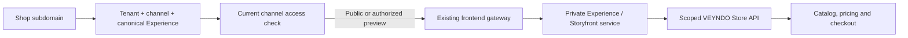
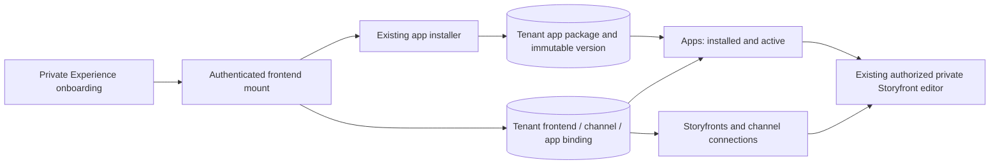

# Sales channels, domains and merchant previews

Sales channels are independently configured storefronts within **one merchant tenant**. A separately registered SaaS shop is a different tenant. Products, members and apps remain tenant-owned; channel settings select the visible catalog, languages, currency, navigation, company and checkout overrides.

## Create a channel, connect a marketplace, build an experience

One shop can sell in several ways without copying its catalogue, customers or
orders. Sales channels select a native commerce context; independent SaaS shops
remain separate tenants.

*Current interface, 2 November 2026, fictional local shop. Earlier outcome-specific examples below retain their original evidence links.*

### Start with where you want to sell

Open **Sales channels → Create sales channel**. Choose Storefront, Headless API,
Point of sale or Marketplace. The cards explain the purpose and show the current
selection. A new draft hides its technical identifier and starts in the shop’s main
content language. Missing required fields are marked next to their controls.

Continue with catalogue/languages, then review. Whole catalogue and the main shop
language are selected initially. POS asks for its location; storefront/headless
channels expose public/private visibility. Marketplace/POS are authenticated native
integration contexts, not public Store API storefronts. Names use the shared
one-language editor and main-language inheritance.

After saving, a completion card offers the next step. **Manage channel** returns to
its existing revisioned editor, dependencies, history, inherited settings and
pause/delete actions. Creating a channel does not connect an external provider or
publish a Storyfront.

### Enter Marketplace Studio in context

**Open Marketplace Studio** keeps the current Studio and channel. If the app is
missing, review its exact package and permission changes in the existing consent
dialog. If paused, activate it with app management permission. The app-owned
Marketplace panel then opens directly; **Connect marketplace** preselects the
channel you just created. Existing app deep links also open the selected app.

The independent Rust marketplace service still owns seller authentication,
projection, sync and inbox. Seller credentials are server-side aliases; enabling
an app is not a live Amazon/eBay/Kaufland account connection. Mapping previews,
explicit synchronization, reviewed paid order intake, invoices and Flow events
remain the [existing marketplace workflow](marketplaces.md).

### Connect Storyfront to the shop you already have

Open **Storyfronts**, choose an active public storefront channel and select
**Create an experience**. Hosted Veyndo opens its existing Experience service with
public shop/channel identifiers. No bearer token or customer information is put
in this URL. If there is no Experience session, use your existing merchant login
or the configured verified email/OAuth path. You can sign out to switch accounts.

[Dated example from the earlier interface: Self-service Storyfront entry inside the merchant workspace](https://github.com/sthamann/veyndo/blob/4b4a658058a2210d9d935f40da81ea57efee262c/docs/assets/channels-20261015/storyfront-create.png)

Confirm the experience name, select an enabled content language and describe the
look and feel. The service checks current Core membership, app/channel management,
settings read/write and catalogue read rights. Invalid/foreign/paused/private/POS
or marketplace channels are refused before a job is created. It never trusts the
URL as authority.

[Dated example from the earlier interface: Creative brief reuses the selected channel’s catalogue](https://github.com/sthamann/veyndo/blob/4b4a658058a2210d9d935f40da81ea57efee262c/docs/assets/channels-20261015/existing-storyfront-brief.png)

The existing durable creation job reuses the current tenant/channel and imports
that catalogue into the **original private Storyfront**. It does not create another
commerce shop or duplicate products. Retries reuse saved progress; a changed channel
revision requires review. Only enabled channel languages are imported. Continue
in the original Studio to edit, generate, preview and go live. Drafting is not
publication; native checkout, stock, prices and orders remain in Veyndo.

```mermaid
flowchart LR
    Admin[Storyfronts: select channel] --> Entry[Existing Experience sign-in]
    Entry --> Rights[Current Core rights and channel]
    Rights --> Job[Existing durable creation queue]
    Job --> Native[Original Storyfront import and editor]
    Native --> Publish[Original Go live and current admission]
    Publish --> Domain[Existing hosted frontend binding]
    Domain --> Checkout[Same Veyndo catalogue and checkout]
```

Rights are checked again at original Studio requests and after asynchronous live
confirmation before selecting its renderer or queuing welcome mail. Revoked access
cannot fall back to an owner broker exchange. Connected shops cannot use the old
separate React design mutation endpoints.

### Hosting and verification boundaries

Hosted `*.veyndo.ai` uses `https://experience.veyndo.ai/connect`. Self-hosters can
supply the public build setting `VITE_EXPERIENCE_ORIGIN` with a plain HTTPS origin
(loopback HTTP is allowed for local development). Server keys, seller credentials
and Storyfront implementation stay private. The normal storefront/POS/marketplace
channel creation flow does not silently install Storyfront.

Screenshots above show a disposable local shop. Browser checks cover native channel
creation, inline errors, in-place Marketplace installation/entry, channel
preselection, Storyfront entry, existing merchant login and actual queued creation.
The isolated private regression uses the original manifest adapter with local
protocol fixtures to reach `studio`, rejects changed jobs/current rights/revisions
and tests revocation during native live confirmation. It performs no paid model,
real seller, email or purchase call. Original hosted generation/publication and
seller acceptance require their configured live services; these screenshots alone
do not prove those external effects.
See [the original Storyfront integration](storyfront.md).

## Point-of-sale channels

POS adds a private authenticated register alongside storefront/headless channels. Location, product grid, receipt translations and channel overrides live on the existing sales-channel/settings owners. Public Store API/UCP checkout is denied; cashier cart ownership and `pos.use` admission are required. [Set up and extend a register](pos.md).

## Studio workflow

Open **Sales channels → Manage channel**. Existing channels can be edited, including the main channel. Saving becomes available after an actual valid change; read-only roles receive an explicit notice. Change names through the shared content-language editor, preserving translations and main-language fallback.

- **Public**: an active channel serves shoppers and public Store API / UCP / MCP calls.
- **Private**: shoppers and public agents are denied. An authorized merchant can open a personal preview.
- **Paused**: public storefront and commerce calls are denied, even for the main channel. Studio remains accessible so it can be resumed.

Pause/resume uses a confirmation dialog. Additional channels use the existing dependency inspection and deletion confirmation. Orders, customers, open carts, settings overrides and connected frontend addresses can block deletion. Disconnect or reassign an address first. Keep channels with historical commerce references paused rather than deleting them. The main channel cannot be deleted or changed to headless; its languages inherit the shop configuration.

**Inherited settings** embeds the existing company, currency, tax, shipping, payment and legal editors. It does not introduce another settings store. On the main channel these edit shared defaults; other channels can override them.

## Domains and Experiences

The **Domains & experiences** tab reads the existing `hosted_frontends` registry. It shows the actual domain, assigned channel, canonical Experience and its original editing link. A second address can point to an already connected Experience owned by the same merchant. Changing an assignment or disconnecting an address uses its current revision; stale writes and foreign IDs fail. Disconnecting removes the address binding, not the Experience, its design or orders.

The built-in interface manages subdomains under the operator's configured wildcard domain. It does **not** provision arbitrary external DNS names or certificates. Operator-selected frontend origins and editor URLs remain server-side configuration; merchants cannot select arbitrary proxy destinations.

The private Experience adapter uses request-local channel context for its existing renderer and commerce API. It never updates canonical ownership or moves SKU data based on a browser header. The **original native Storyfront renderer** has an immutable imported tenant/channel binding: moving its domain to another channel fails closed at that adapter. Import an Experience for the intended channel before switching a native workspace. Reusing its renderer across channels and forwarding private preview grants into the upstream native runtime remain separate integration work; the generic registry must not pretend they already work.

## Personal preview security

`POST /api/automation/channels/{id}/preview` requires a current personal merchant session and `settings.read`. An integration API key or bootstrap token cannot mint browser previews. The returned one-use link expires after 60 seconds. Redeeming it rotates the token into a **host-only HttpOnly cookie**, with Secure on HTTPS, SameSite=Lax and a 15-minute expiry. It is bound to tenant, channel revision, personal session, current membership/permissions and, where selected, the frontend address.

Every request rechecks admission. Channel changes, session expiry, logout or revoked membership invalidate the grant. Forged identity/preview-principal headers are removed before authentication. A preview token from another tenant, channel or host is denied. Authenticated and hosted responses are not browser/CDN cached; the renderer can still use internal scene caches after admission.

Previews permit bounded cart simulations and catalog reads. They **cannot place orders**, change customer accounts, run paid AI actions or finalize payments. The standard frontend marks preview mode, suppresses analytics/account editing and disables checkout submission. The existing private Experience interface has its own preview indication; Core remains the security boundary regardless of UI controls.

## API and source ownership

| Operation | Existing owner / new responsibility |
|---|---|
| Channel list/save/delete/dependencies | `components/marketing/src/service/configuration_writes.rs`, `http/configuration.rs`, `store/dependencies.rs`; POS setup through the `ConfigurationHost` port |
| Shared request admission | `components/marketing/src/service/channel_access.rs`, called by `src/auth/middleware.rs` |
| Session-bound handoff and revocation | `components/marketing/src/http/channel_preview.rs` and `service/channel_preview.rs`; the schema baseline and forced tenant RLS |
| Catalog/cart/navigation/legal reads | Existing consumers use only the server-derived preview marker |
| Frontend alias CRUD and revision checks | `components/apps/src/service/frontend_bindings.rs` (managed-app install through the `HostedInstall` port); existing `hosted_frontends` table |
| Actual proxy and streamed responses | `src/shop_domains/frontends.rs`, `frontend_transport.rs` |
| Channel editor / lifecycle actions / domains | `components/marketing/ui/admin/channels/ChannelEditor.tsx`, `ChannelActions.tsx`, `ChannelConnections.tsx` |
| Standard shop preview notice | `frontend/src/storefront/shell/ChannelPreview.tsx` and four-language `channel-preview-i18n.ts` |

Domain CRUD is `GET/PUT /api/settings/frontends` and `DELETE /api/settings/frontends/{alias}`. Changes require `settings.write`; list requires `settings.read`. Aliases are globally unique, but ownership and channel references are tenant-scoped. PUT supports `alias`, `channel`, `experienceAlias` and `revision`; unchanged legacy provisioning remains idempotent.

## Verification and limits

`scripts/channel_management.py` creates two synthetic shops and exercises CRUD, stale revisions, foreign IDs, private Store API/UCP/MCP, default pause/resume, dependencies, actual hosted proxy headers, one-use preview handoff, paused catalog preview, order/account-write denial and logout revocation. It runs in the central integration suite registry with disposable PostgreSQL data and a loopback frontend fixture. UI tests exercise editing, assignment and disconnect confirmation. Existing settings, tenancy, checkout, staging and broker regressions cover surrounding paths.

The pure channel admission decision is extracted into Lean with private/paused/preview claims and deliberate failing mutations. This proves the extracted decision under its input assumptions; it does not prove SQL, authentication, proxies, rendering, native Storyfront or the entire commerce system.

## Storyfront app ownership for Experience shops

An Experience is mounted through the same `PUT /api/settings/frontends` transaction,
with `appId: "storyfront"`. The core installs the bundled public integration manifest
through `apps::registry::install_tx`, then commits the frontend binding. It does not
load the private Storyfront implementation. Repeating an unchanged mount preserves
both frontend and app revisions. Additional domains inherit the canonical Experience's
app association; an ordinary custom frontend without `appId` does not install it.

A deferred composite `(tenant,app_id)` foreign key prevents a binding from borrowing
another tenant's app. GET requests never provision or repair installations. Generic
mounts remain unassociated unless their application is explicitly supplied.

`GET /api/apps` reports `managedBy: "experience"` and its owned `connections`. Apps
and Storyfronts reuse the same connection card and safe editor URLs. While any
frontend depends on the package, deactivation returns 409 under the same
configuration lock used by mounting. Disconnecting the last binding releases that
restriction and preserves app data and version history. Channel pause/privacy
remains separate and continues to protect the public storefront.

The existing private `status` app action (HTTP/MCP) returns these authoritative
connection records; `connected` describes a binding, not a live renderer health
check or proof of publication. Managed `generate` directs the merchant to the
original editor rather than starting a second generator. Optional legacy service
connectors retain their existing contract for shops without managed bindings.

The real PostgreSQL `channel_management`, `identity_broker` and `tenant_isolation`
suites cover installation/idempotency, old-data migration/restart, foreign-shop
rejection, dependency protection and composite foreign keys. UI tests cover
localized navigation and suppressing duplicate legacy editors. SQL/network
adapters remain outside the Lean proof boundary.
