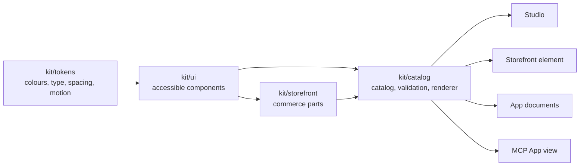

# Design system

Veyndo's interface is one component language. Studio, the storefront, installed
apps, MCP Apps and agents build screens from the same kit components and the same
catalog. A screen written by a person in code and a view an agent describes in a
document use the same components and the same validation, styles and
accessibility rules.



## Layers

| Package                                                      | Owns                                                                  | Rule                                                                |
| ------------------------------------------------------------ | --------------------------------------------------------------------- | ------------------------------------------------------------------- |
| [`kit/tokens`](../frontend/src/kit/tokens/README.md)         | Colours (light and dark), type, spacing, radii, shadows, motion       | `tokens.json` is the only source; components use `var(--vy-*)` only |
| [`kit/ui`](../frontend/src/kit/ui/README.md)                 | Buttons, fields, notices, tabs, menus, dialogs, layout                | Label-free: every text comes from the caller's vocabulary           |
| [`kit/storefront`](../frontend/src/kit/storefront/README.md) | Product card, buy box, cart summary, checkout steps, account parts    | Prices, stock and totals come only from the server                  |
| [`kit/catalog`](../frontend/src/kit/catalog/README.md)       | The versioned catalog, document validation, the renderer, the gallery | The one way to render a UI document from an agent, app or MCP App   |

A package imports only lower packages; `npm run architecture` enforces the order
and refuses colour literals in kit stylesheets. Brand themes adjust token values
per shop; they never add components or styles of their own.

## The component catalog

Every reusable component is declared once in kit/catalog with:

- a JSON-Schema-compatible **props schema** (Zod), with safe field types for plain
  text, URLs and identifiers;
- **slots** that name the components they accept and how many;
- **events** with a payload schema;
- an **accessibility contract**: role, WAI-ARIA pattern, where the accessible name
  comes from, keyboard support and notes;
- the **surfaces** that admit it (`studio`, `storefront`, `app`, `mcp-app`);
- **examples** for each relevant state.

The catalog has an id (`veyndo:components/1`) and a semantic version. Additive
changes raise the minor version. A breaking change needs a new major id, so a
document that names `veyndo:components/1` keeps its meaning.

Three artifacts are generated from that source:

| Artifact                                                                 | Readers                                                                                                     |
| ------------------------------------------------------------------------ | ----------------------------------------------------------------------------------------------------------- |
| [`catalog.json`](../frontend/src/kit/catalog/catalog.json)               | Agents, prompts, other languages and external renderers                                                     |
| [`kit/ui/props.generated.ts`](../frontend/src/kit/ui/props.generated.ts) | kit/ui itself (tones, sizes, layout options) and TypeScript document authors (`DocumentNode`, `UiDocument`) |
| [Component gallery](component-gallery.md)                                | People reading the handbook                                                                                 |

`npm test` fails when any artifact differs from the source. After changing an
entry, run `WRITE_COMPONENT_CATALOG=1 npm test -- component-catalog` in
`frontend/` and commit the regenerated files.

Some kit components are listed as **code only**: `Dialog` (a document may not open
a modal over its host), `IconButton` (icons are code) and `Field` (documents use
the labelled controls). They appear in the catalog and the gallery but are refused
in documents.

## Documents and surfaces

A document is data, never code. The renderer accepts three formats:

- `veyndo-ui/1`: nested JSON, `{format, catalog, root}`. Generated TypeScript types
  describe it.
- A2UI v1.0: `createSurface` names the catalog id; `updateComponents` lists flat
  components that refer to each other by id. A document cannot send
  `updateDataModel`; the host supplies the data.
- OpenUI Lang: `root = Stack([Badge("New")], "2")`. Arguments are positional in the
  order `catalog.json` lists under `openUi.arguments`. The default slot comes first.

Each surface renders documents through `CatalogView` with an **admission**: the
surface, the locale, the data it resolved under the current user's rights, the
action names it handles, the https origins links and images may use, and its own
host components. [Agentic component UI](agentic-component-ui.md#one-catalog-one-renderer)
lists the four entry points.

### What the renderer refuses

| Refusal                       | Example                                                                                  |
| ----------------------------- | ---------------------------------------------------------------------------------------- |
| `unknown-component`           | A component that is not in the catalog or registered by the host                         |
| `not-admitted`                | `IconButton` in any document; `AccountOverview` in an MCP App                            |
| `invalid-props`               | `tone: "neon"`, an empty label, an unknown prop                                          |
| `unsafe-html`                 | Markup in text, `dangerouslySetInnerHTML`, `onClick`, `style`                            |
| `unsafe-url`                  | `javascript:`, `data:`, `//host`, `http:`, credentials, an origin the host did not admit |
| `data-not-admitted`           | A `{"path": …}` binding to data the host did not resolve; a price stated as a literal    |
| `slot`, `placement`           | A text in a notice's action slot; a tab panel outside tabs                               |
| `action`                      | An action name the host does not handle; an action on a component without events         |
| `limits`, `format`, `catalog` | More than 400 nodes or 16 levels; unreadable input; another catalog id                   |

A refused node shows a localized notice in its place (English, German, French,
Spanish); the rest of the document still renders. A document-level refusal
replaces the whole view with one notice. A component that throws while rendering
is caught by its node's boundary and shows the same notice.

Commerce patterns such as `ProductCard` and `CartSummary` declare their commerce
props as **host data**. A document must bind them to data the host admitted
(`{"product": {"path": "/product"}}`); a document that states a price or stock
itself is refused. That keeps prices, availability and totals with Commerce and
Checkout, wherever the view came from.

## Accessibility

Every entry states its contract, and tests hold each entry to it:

- `npm test` renders every example in every shipped language, checks the declared
  role and accessible name, and runs axe on the result (contrast excluded, since
  jsdom has no layout).
- The nightly `component_gallery` check renders the standalone gallery in
  Chromium. It runs axe on English and German pages, contrast included.

Interactive components follow the WAI-ARIA authoring patterns (tabs with roving
focus, menu button, modal dialog with focus containment and restoration, switch).
Motion stops under `prefers-reduced-motion`.

## Visual regression

The nightly check also screenshots every example frame (light and dark, English
and German) and compares it with the baselines in
`frontend/tests/visual/gallery/<platform>/`. A frame fails when more than 1% of
its pixels change by more than a small tolerance; the actual image is kept in
`artifacts/component-gallery/`. Both environments render with the same installed
font, so the baselines do not depend on the machine's default fonts.

After an intended visual change (for example new token values), rebuild the
frontend and update the baselines in the same Linux image CI uses:

```bash
docker run --rm -v "$PWD:$PWD" -w "$PWD" mcr.microsoft.com/playwright/python:v1.65.1-noble sh -c 'pip install -q playwright==1.65.1 && python3 -m playwright install chromium-headless-shell && python3 scripts/component_gallery.py --update'
```

The command needs `frontend/node_modules` (for axe-core) and a current
`npm run build`.

## Where to look

- Studio: **Developer → Components** shows the live gallery in the Studio language,
  with sample languages switchable.
- Handbook: the [component gallery](component-gallery.md) with each contract and
  static renders.
- Code: [kit/catalog](../frontend/src/kit/catalog/README.md).

## Checks

| Check                  | Where                   | Scope                                                                   |
| ---------------------- | ----------------------- | ----------------------------------------------------------------------- |
| `component-catalog`    | `npm test`              | Generated catalog, types and gallery page match the source              |
| `component-renderer`   | `npm test`              | Every example in four languages with roles and axe; every refusal       |
| `component-surfaces`   | `npm test`              | MCP App view, storefront element and app documents use the renderer     |
| `kit-ui`               | `npm test`              | Primitives, components and that every kit/ui export has a catalog entry |
| `npm run architecture` | frontend CI             | Layering, token use; OpenUI renders only inside kit/catalog             |
| `component_gallery`    | nightly `tooling` suite | Chromium axe with contrast and visual snapshots                         |
