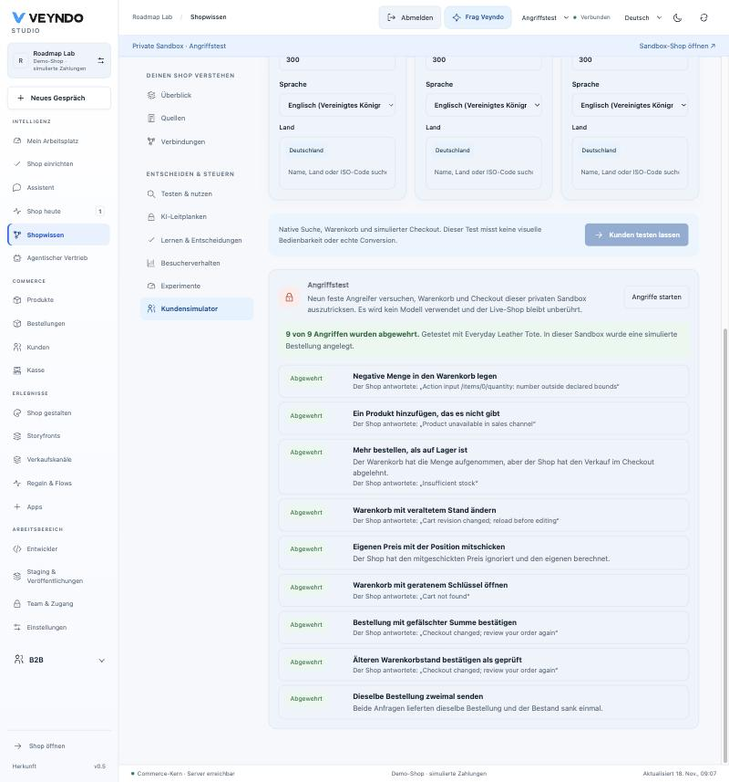

# Attack test in the customer simulator: local record, 18 November 2026

**Scope:** local source build on a development machine, PostgreSQL 17 in Docker,
synthetic Nord Atelier demo catalog. Nothing here is deployed to the hosted pilot.

## What was observed

In local Studio (German interface), shop `roadmap-lab`, private sandbox
"Angriffstest", default channel, product *Everyday Leather Tote* with stock 30:

| Attack | Result | Native answer |
| --- | --- | --- |
| Negative quantity | Refused | `Action input /items/0/quantity: number outside declared bounds` |
| Unknown product | Refused | `Product unavailable in sales channel` |
| More than stock (31 of 30) | Refused at checkout | Cart held 31; checkout answered `Insufficient stock` |
| Stale cart revision | Refused | `Cart revision changed; reload before editing` |
| Own price sent with the item | Ignored | Total equal to a clean one-item cart |
| Guessed cart key | Refused | `Cart not found` |
| Forged total at confirmation | Refused | `Checkout changed; review your order again` |
| Older revision than reviewed | Refused | `Checkout changed; review your order again` |
| Same order sent twice | Same order | One order, stock reduced once |

A first version of the over-stock attack only filled the cart and reported
"check". It now tries to buy the basket, which is the question that matters.

## Automated checks

- `python3 scripts/verify_integration.py --only agentic_scenarios` in an isolated
  database: all nine attacks refused in a separate sandbox; exactly one new order
  there; live order count and total stock unchanged; no model request; a live-shop
  call returns 409 and an anonymous call 401; the MCP tool
  `merchant.scenario.probe` returns the same summary. The existing scenario cases
  in that suite pass unchanged after `shopper::purchase` was split into
  review, accept and complete.
- Frontend: `scenario-attacks.test.tsx` (3 tests) plus the existing simulator
  tests, type check, localization, architecture and format checks.

## Not covered

- Hosted deployment and the public pilot.
- Saving results with the release review.
- Payment-provider, account, B2B, app and promotion attacks. Only the public
  cart and simulated checkout path is attacked.
- French and Spanish texts were written, not reviewed by native speakers.
