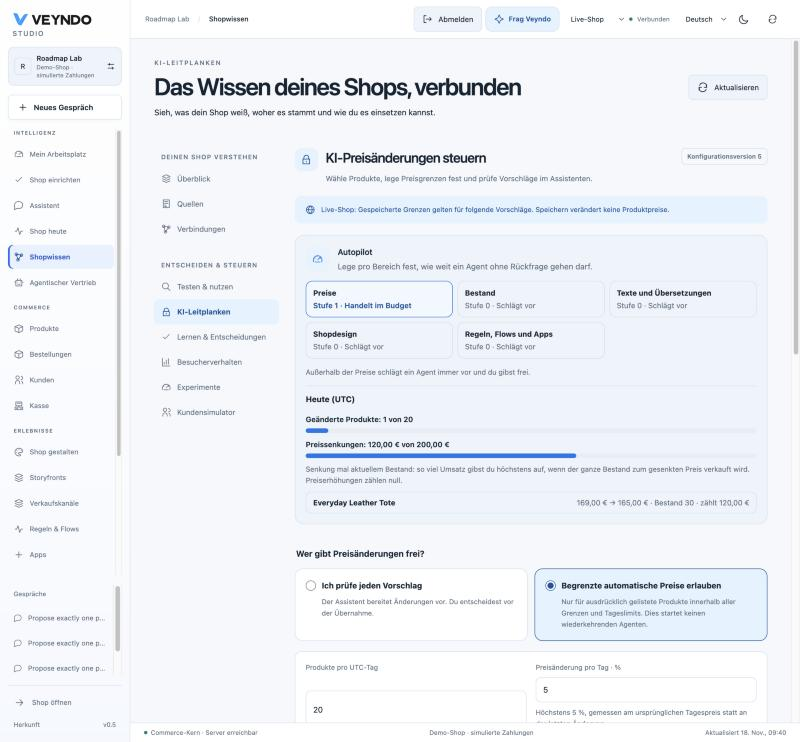

# Autopilot levels and daily limit: local record, 18 November 2026

**Scope:** local source build on a development machine, PostgreSQL 17 in Docker,
synthetic Nord Atelier demo catalog, local Ollama model `qwen3.6:35b`. Nothing
here is deployed to the hosted pilot.

## What was observed

Live shop `roadmap-lab` of the local installation, product *Everyday Leather
Tote* (169.00 EUR, stock 30), price boundary 160 to 175 EUR, automatic prices
allowed with 5 % daily movement, 20 products per day and a daily limit for price
reductions of 200.00 EUR.

1. The local model prepared a proposal to set the price to 165 EUR. The first
   attempt failed because the model mixed a list view into the change; a second,
   stricter instruction produced a price-only proposal.
2. `knowledge.autonomy.apply` applied it. Counted: (169.00 - 165.00) × 30 =
   120.00 EUR.
3. A further proposal to 162 EUR would count (169.00 - 162.00) × 30 = 210.00
   EUR. The apply was refused with HTTP 409, "Autonomy would exceed today's
   exposure limit for price reductions", and the price stayed 165.00 EUR.
4. Studio showed prices on level 1, one of 20 products, 120.00 of 200.00 EUR and
   the changed product.

## Automated checks

- `python3 scripts/verify_integration.py --only users providers` in an isolated
  database, case "Autonomy refuses price reductions beyond the daily exposure
  limit": refusal at limit 1 and at one minor unit below the needed amount with
  an unchanged price, apply at the exact amount, status over HTTP and the MCP
  tool with the same figure, another shop sees only its own empty use, and a
  limit above the allowed maximum is rejected when saving settings.
- Rust unit test for the counting function (reductions, increases, zero and
  negative stock, extreme values).
- Frontend: `autopilot-today.test.tsx` (3 tests) and the existing guardrail
  tests, type check, localization, architecture and format checks.

## Known failure outside this change

The later personal-account case of the `providers` suite ("Personal reader can
plan; only authorized editor executes") fails locally with HTTP 403. The
unchanged previous commit fails at the same line, so it is not caused by this
change. It was not investigated here.

## Not covered

- Hosted deployment and the public pilot. The full daily suite was not run.
- No automatic rollback on sales or conversion.
- The counting function and the database read are reviewed but unproved Rust.
  The existing Lean-extracted rule `ai_autonomy_admissible` is unchanged; the
  limit enters it as part of its daily-budget input.
- Products priced in another currency than the shop's pricing currency are
  refused while a limit is set.
- French and Spanish texts were written, not reviewed by native speakers.
