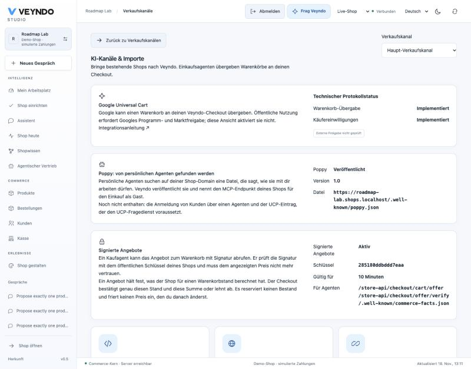

# Poppy discovery file: local record, 18 November 2026

**Scope:** local source build on a development machine with the shop domain
suffix `shops.localhost`, PostgreSQL 17 in Docker, synthetic shop `roadmap-lab`.
Nothing here is deployed to the hosted pilot, and no real personal agent was
involved.

## What was observed

`curl http://roadmap-lab.shops.localhost:8787/.well-known/poppy.json` returned
HTTP 200, `content-type: application/json`, `access-control-allow-origin: *` and:

```json
{"apis":[{"description":"Guest shopping over MCP: …","type":"mcp","url":"https://roadmap-lab.shops.localhost:8787/mcp"}],"organization":{"domain":"roadmap-lab.shops.localhost:8787","name":"Roadmap Lab"},"protocol_version":"1.0"}
```

- The same path on `127.0.0.1:8787` and on an unknown shop host returned 404.
- `tools/list` on the shop host's `/mcp` returned 39 tools, among them
  `catalog.search`, `cart.create`, `cart.offer`, `offer.verify` and
  `checkout.complete`.
- Studio showed the Poppy card as published with the file address.



## Checks

- **Official schema.** A document of this shape validated against the Poppy
  JSON Schema from the protocol repository
  (`kit/company/schemas/poppy.schema.json`, draft 2020-12), fetched on 18
  November 2026. Three negative controls (no `apis`, version `1`, an `http`
  endpoint) were rejected by the same schema. The schema is not vendored into
  this repository.
- `python3 scripts/verify_integration.py --only users providers`, case "Poppy
  discovery": exact fields; domain equals the shop host; HTTPS MCP endpoint on
  that host; 404 without a shop host, with only a shop header, for an unknown
  shop and for a former domain; the named endpoint lists guest shopping tools;
  Studio readiness reports the address.
- Rust unit tests: the document has no sign-in, session, task or UCP claims;
  only the exact configured host is served and a non-default port is kept.
- Frontend unit test for the Studio card; type check, localization,
  architecture and format checks.

## Not covered

- Hosted deployment, and a fetch by a real agent such as Meta's.
- HTTPS itself: locally the file was fetched over HTTP, while the document
  names HTTPS endpoints as the protocol requires.
- The parts of the specification after section 4.1 were read only in summary.
  Sierra's own kit calls the specification a draft.
- Sign-in, sessions, tasks, the UCP entry and Web Bot Auth.
- The response carries the installation's default `cache-control: private,
  no-store`; the specification sections read set no caching rule.
