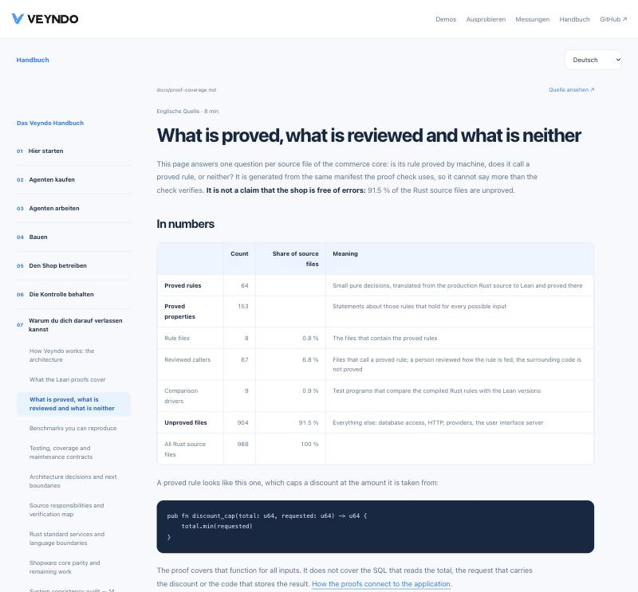
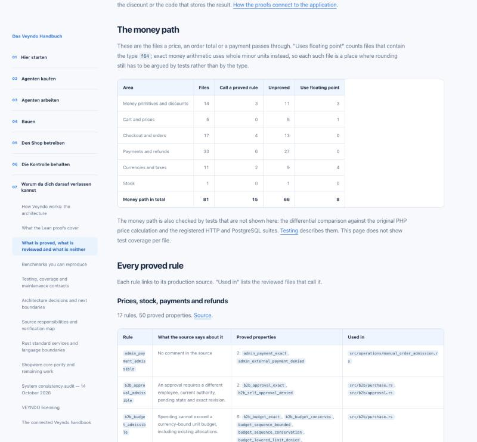

# Proof coverage page: local record, 18 November 2026

**Scope:** a generated handbook page and its check. No Rust, Lean or policy was
changed, and nothing new was proved.

## What was observed

`python3 scripts/formal/coverage_page.py` wrote `docs/proof-coverage.md` from
`proof/manifest.json` and the rule sources in
`crates/kernel/src/verified_kernel/`. On this commit it reports:

| Figure | Value |
| --- | ---: |
| Proved rules | 64 |
| Proved properties | 153 |
| Rule files | 8 |
| Reviewed callers | 67 |
| Comparison drivers | 9 |
| Unproved source files | 904 of 988 (91.5 %) |
| Money path files | 81 |
| Money path files that call a proved rule | 15 |
| Money path files that are unproved | 66 |
| Money path files that contain `f64` | 8 |

The handbook build rendered the page with nine tables and no horizontal
overflow at 1400 pixels.

## Checks

- `python3 scripts/formal/coverage_page.py --check` passes and is part of the
  required quick check. It fails when the page differs from the manifest, when
  a kernel rule is missing from the manifest, when a listed rule has no proved
  property or when a rule's caller is not a reviewed source. Two negative
  controls run on every invocation.
- The existing proof registry check passes with the review recorded for the new
  script and workflow step.
- Handbook build and site check pass with the page in the navigation.

## What the page does not show

- **Test coverage per file.** The roadmap entry originally promised "proved,
  tested or neither". The page shows proved, reviewed caller or neither; which
  files are exercised by which test suite is not part of the manifest.
- **Whether the money path definition is complete.** It is a fixed list of
  directories and file name patterns in the script. A file outside that list
  that handles money is not counted.
- **Floating point use is counted by the presence of the type `f64` in a file**,
  not by whether a money amount actually passes through it.
- 21 of the 64 rules have no comment in the source, so the page says so instead
  of describing them.
- The earlier dated figures in `docs/testing.md` and in older records are left
  as they were; they describe their dates.
