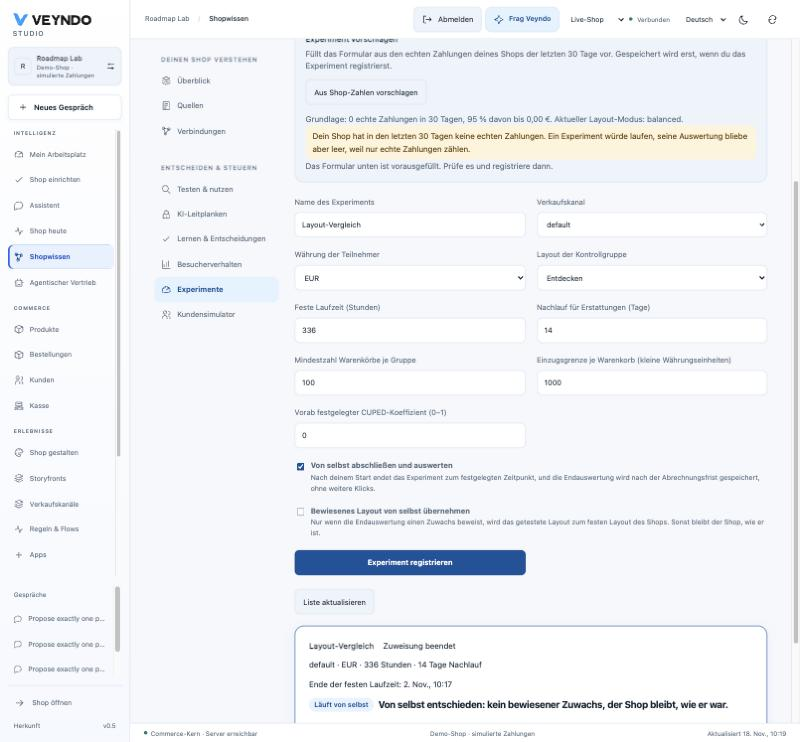

# Experiments that run themselves: local record, 18 November 2026

**Scope:** local source build on a development machine, PostgreSQL 17 in Docker,
synthetic Nord Atelier demo shop **without live payments**. Nothing here is
deployed to the hosted pilot, and no real visitor or payment was involved.

## What was observed

In local Studio (German interface), live shop `roadmap-lab`:

1. **Suggest from shop figures** prefilled the form: control "discovery", 336
   hours, 14 settlement days, 100 per group, automatic finish on, automatic
   adoption off. It stated its basis (0 live payments in 30 days, layout mode
   "balanced") and warned that the readout would stay empty.
2. The experiment was registered and started by hand. It showed the badge
   "Runs by itself".
3. The clock of that experiment was moved in the local database so that its run
   and settlement period lay in the past. About 33 seconds later the worker had
   set it to completed and recorded the decision "kept".
4. Studio showed "Decided by itself: no proved uplift, the shop stays as it
   was", zero units per group and zero collected.

## Automated checks

`python3 scripts/verify_integration.py --only cognitive_experiments` in an
isolated database, all cases passing:

- The suggestion saves nothing and returns a valid design.
- Adopting without finishing is rejected when registering.
- A self-running experiment past its settlement period is completed, read out
  and decided "kept" by the worker; the shop's layout mode is unchanged; two
  events carry the worker as actor.
- With a **seeded** mature readout that claims a proved uplift, the worker
  records "published" and sets the shop's layout mode to the treatment.
- An experiment without automation stays running until the merchant acts.

Frontend: five unit tests for the suggestion card, the switches and the decision
note, plus type check, localization, architecture and format checks.

## Not covered

- **No real experiment ran.** There were no live payments, no consenting real
  visitors and no real waiting time. The proved-uplift path was exercised with a
  seeded readout, not with measured data.
- Hosted deployment. The full daily suite was not run.
- With several replicas each process runs the step; the state checks in the
  updates prevent a double transition, but this was not tested with two replicas.
- Two frontend unit tests unrelated to this work (`site-workspace`,
  `studio-workspaces`) fail on this branch and on the commit before the roadmap
  work.
- French and Spanish texts were written, not reviewed by native speakers.
