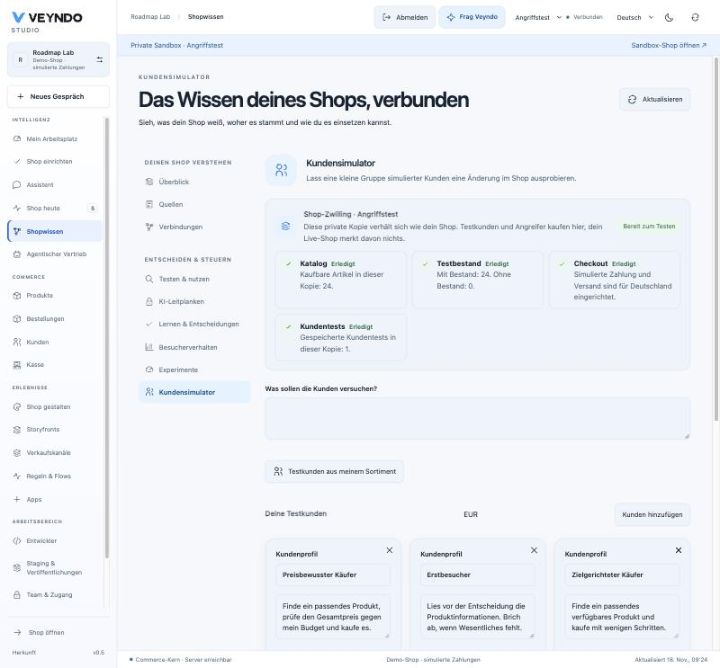
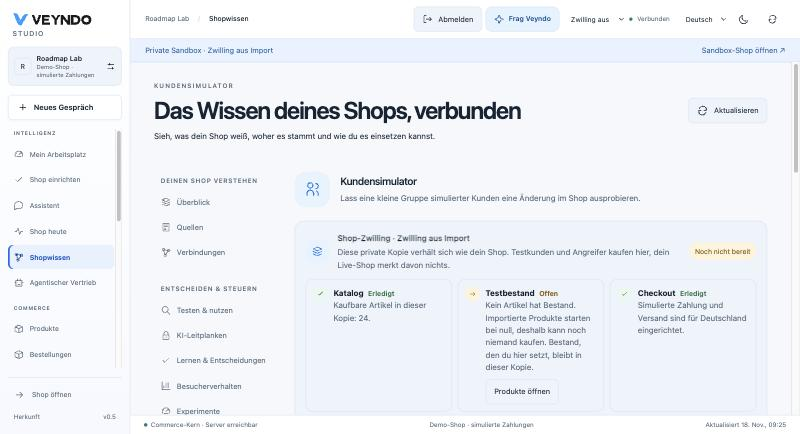

# Shop twin readiness: local record, 18 November 2026

**Scope:** local source build on a development machine, PostgreSQL 17 in Docker,
synthetic Nord Atelier demo catalog, local Ollama model `qwen3.6:35b` for the
customer test. Nothing here is deployed to the hosted pilot.

## What was observed

Local Studio (German interface), shop `roadmap-lab`.

**Sandbox "Angriffstest", a copy of the demo shop.** The Shop twin panel showed
24 purchasable items, 24 with stock, simulated payment and shipping for Germany,
and "Ready to test". After one customer test with three fictional customers on
the local model (the first customer completed a simulated purchase), the fourth
step changed to done with one saved test.

**Sandbox "Zwilling aus Import", stock set to zero.** To reproduce the state
after a catalog import, the stock of all 34 product rows of this local sandbox
was set to zero directly in the test database. The panel showed "Not ready yet",
the open step **Test stock** with its explanation and the **Open products** action.

## Automated checks

- `python3 scripts/verify_integration.py --only agentic_scenarios` in an isolated
  database: a fresh sandbox is ready with no blockers; HTTP and the MCP tool
  `merchant.scenario.readiness` return the same catalog figures; a live-shop
  call returns 409 and an anonymous call 401; after stock is set to zero the
  only blocker is `no_stock`, the attack test refuses to start, and the live
  shop is unchanged.
- Frontend: `scenario-twin.test.tsx` (3 tests: ready copy, zero-stock blocker
  with rights-dependent action, foreign response shape and native error), plus
  type check, localization, architecture and format checks.

## Not covered

- **No catalog was imported for this record.** The Shopify CSV, generic CSV and
  Migration Assistant paths have their own earlier records; the zero-stock state
  here was produced by a database update, not by an import.
- Hosted deployment and the public pilot.
- Readiness looks at the first delivery country and a sample of up to twelve
  items in the selected sales channel.
- The twin has no bulk action to set test stock; stock is set per product.
- French and Spanish texts were written, not reviewed by native speakers.
