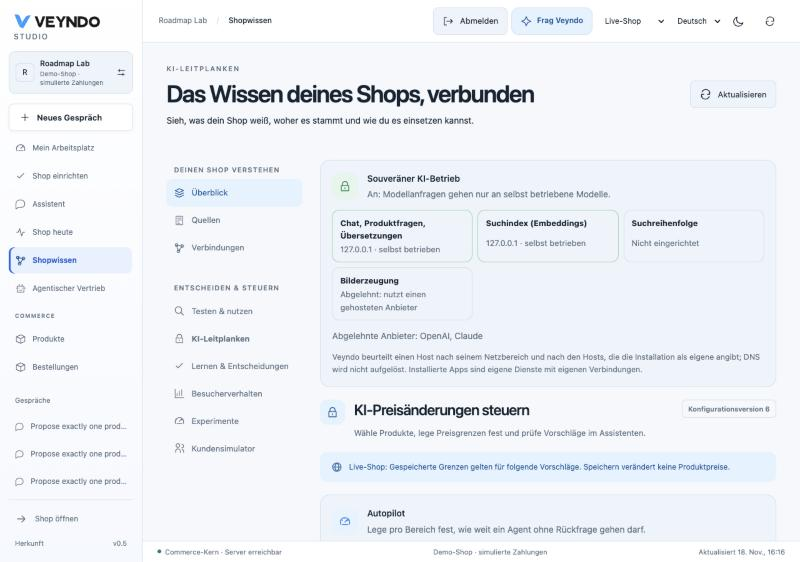

# Sovereign AI mode: local record, 18 November 2026

**Scope:** local source build on a development machine, PostgreSQL 17 in
Docker, synthetic shop `roadmap-lab`, local Ollama model `qwen3.6:35b` on
`127.0.0.1`. Nothing here is deployed to the hosted pilot. No real OpenAI or
Anthropic endpoint was contacted at any point.

## What was observed

With the mode switched on in the local database:

- `POST /api/agent/chat` with `inference.provider: "openai"` returned the
  message "Provider disabled by platform operator" and no proposal.
- The same request with the platform default was answered by the local model
  (`inference: ollama`).
- Studio → Shop knowledge → AI guardrails showed the mode as on, `127.0.0.1` as
  self-hosted for text and embeddings, no reranker, image generation refused,
  and OpenAI and Claude as refused providers.

## Checks

- `python3 scripts/verify_integration.py --only platform`, case "sovereign AI
  mode", on the real HTTP and PostgreSQL path with two local fixtures:
  1. With the mode off, a chat that selects the hosted provider reaches the
     fixture that stands in for it. This shows the hosted route was live.
  2. Saving the switch with an external text endpoint is refused (HTTP 422).
  3. With the mode on, chats that select OpenAI and Claude send **no** request
     to that fixture; the merchant provider list shows both as unavailable and
     the default as the local route; the report names host `127.0.0.1` and
     contains neither the key nor the fixture port.
  4. A chat on the platform default is still answered by the local fixture.
- Rust unit tests: which hosts count as self-hosted (10 accepted, 8 refused,
  among them `localhost.example.com` and `172.32.0.1`); the mode disables both
  hosted providers, refuses an external endpoint on the local route and keeps
  key material out of the report.
- Frontend unit tests for the Studio card (on, on with a refused route, off,
  no report); type check, localization, architecture and format checks.

## Not covered

- Hosted deployment, and a run with real hosted provider keys.
- The deployment variable `SOVEREIGN_AI=true` and `SOVEREIGN_MODEL_HOSTS` were
  exercised by unit tests of the host rule only, not by a suite run with the
  variables set.
- Embedding and reranker refusal with an external `EMBEDDING_BASE_URL` or
  `RERANKER_URL` was not run end to end; the same gate function is covered by
  the unit tests and the save-time refusal.
- DNS: an internal-looking name that resolves to an outside address is not
  detected. The guide says so.
- The operator switch in the platform console was type-checked and saved
  through the API in the suite, but not clicked in a browser.
- Apps and non-model providers are outside the mode.
- French and Spanish texts were not reviewed by native speakers.
