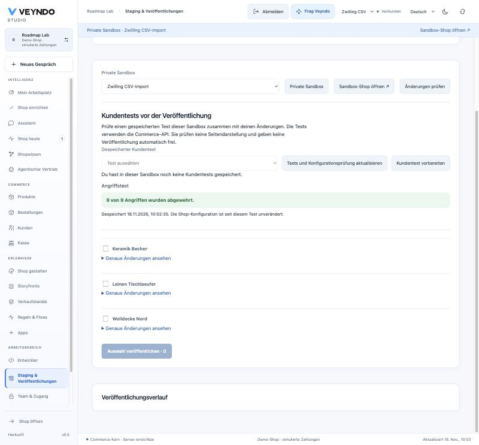
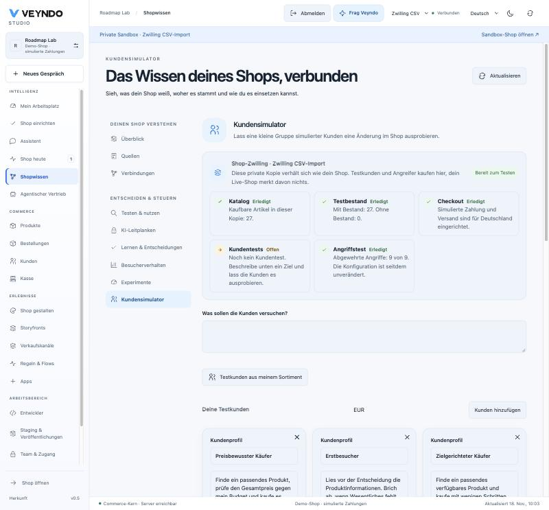
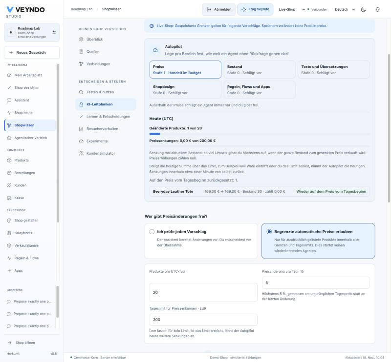

# Completing roadmap stages 1 to 3: local record, 18 November 2026

**Scope:** local source build on a development machine, PostgreSQL 17 in Docker,
synthetic Nord Atelier demo catalog. Nothing here is deployed to the hosted
pilot. This record covers the three gaps named in the first records of the
[attack test](attack-test-2026-11-18.md), the [shop twin](shop-twin-2026-11-18.md)
and the [autopilot](autopilot-2026-11-18.md).

## Stage 1: attack results are saved and shown before release

- Each run is stored as an applied, actor-private task row of the sandbox
  (ten most recent kept). The panel shows the last one again with its
  configuration freshness.
- **Staging & releases** shows "9 of 9 attacks were refused", the save time and
  "configuration unchanged since" beside the pending changes. The summary comes
  with the existing scenario list read; no second request.

## Stage 2: a real import and one-click test stock

Through the API of the running local server, signed in as the test owner:

1. Created the sandbox "Zwilling CSV-Import".
2. Prepared a three-line generic CSV and saved the three drafts with explicit
   approval. All three were created with stock 0.
3. Readiness reported 27 purchasable items, 24 with and 3 without stock.
4. `merchant.scenario.stock` with quantity 10 updated exactly 3 items; 0 remained.
5. The attack test picked the imported "Keramik Becher"; 9 of 9 refused; the
   report was saved and read back as current.

Studio then showed the twin with five steps and the release review listed the
three imported products as pending changes.

## Stage 3: rollback by request and by the worker guard

- In Studio, **Take back** on the bag restored 165.00 EUR to 169.00 EUR; today's
  use went from 120.00 EUR to 0.00 EUR.
- The provider suite additionally lowers the limit below today's total and
  waits for the worker guard: the price returned to the day baseline without a
  request. A price changed by hand afterwards was skipped with `changed_since`.

## Automated checks

- `--only agentic_scenarios`: saved report read back as current, visible in
  readiness, invisible from another sandbox, 409 for the live shop; test stock
  refused without approval, above 1000 and for the live shop, fills exactly the
  empty items, leaves stocked items alone; the attack test runs again afterwards.
- `--only users providers`, autonomy case: rollback requires approval, restores
  the baseline, reports `at_baseline` on repetition, the worker guard restores
  after the limit is lowered, a manual price is never overwritten.
- Frontend: 54 related unit tests including saved report, stale configuration,
  test-stock action and the five-step twin; type check, localization,
  architecture and format checks.

## Still not covered

- Hosted deployment and the public pilot. The full daily suite was not run
  locally; the scheduled full run on `main` was already failing on 16 and 17
  November, before this work.
- The later personal-account case of the `providers` suite fails with 403 on
  this branch and on the commit before stage 3.
- Only the generic CSV import was run. Shopify CSV and the Migration Assistant
  were not repeated.
- The guard was observed in the test suite, not timed in Studio. With several
  replicas each process checks on its own; a double restore is prevented by the
  product revision.
- Rollback restores the price only. It does not undo orders placed at the lower
  price, and there is no trigger on sales or conversion.
- French and Spanish texts were written, not reviewed by native speakers.
