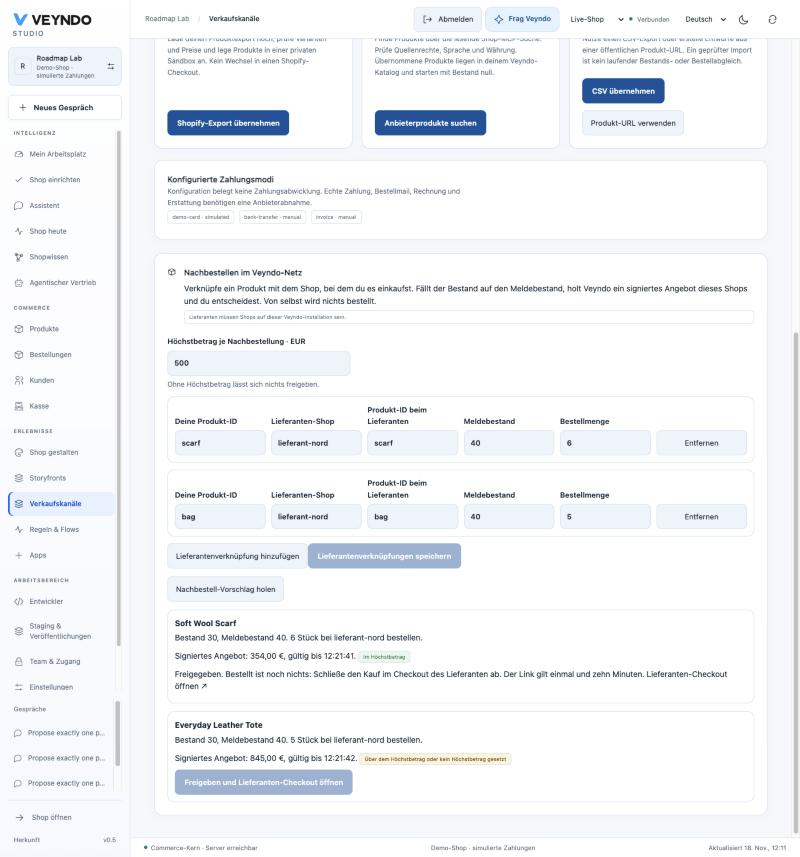

# Reordering between shops: local record, 18 November 2026

**Scope:** local source build on a development machine, PostgreSQL 17 in Docker,
two synthetic shops on one installation (`roadmap-lab` as buyer, `lieferant-nord`
as supplier), both with the Nord Atelier demo catalog. Nothing here is deployed
to the hosted pilot, and no order was placed.

## What was observed

1. In the buyer shop two supplier links were saved with a ceiling of 500.00 EUR:
   scarf (reorder point 40, quantity 6) and bag (reorder point 40, quantity 5),
   both from `lieferant-nord`. Both products had stock 30.
2. **Get reorder proposal** in Studio showed two lines with signed offers from
   the supplier shop: scarf 354.00 EUR, "within the ceiling"; bag 845.00 EUR,
   "above the ceiling", with its approve button disabled.
3. **Approve and open supplier checkout** on the scarf returned a link to
   `/checkout?shop=lieferant-nord…`. Opening it showed the supplier shop's
   checkout with the scarf order and a total of 354.00 EUR. The purchase was not
   completed.

## Automated checks

- `python3 scripts/verify_integration.py --only users providers`, case "Reorder
  proposals": duplicate links and a zero quantity are rejected when saving; the
  proposal carries an offer from the other shop that verifies independently
  with Ed25519; approval needs explicit approval, a saved ceiling and an offer
  at or below it; a forged total and a product without a link are refused;
  approval returns a single-use supplier checkout link and the supplier's order
  count is unchanged; a shop cannot be its own supplier; a product above its
  reorder point produces no line; a caller without merchant login gets 401.
- Rust unit test for supplier link validation.
- Frontend: three unit tests for the reorder view (offers, ceiling, approval
  link, unsaved edits, read-only role), plus type check, localization,
  architecture and format checks.

## Known failure outside this change

The later personal-account case of the `providers` suite fails with 403, as on
the commits before this work.

## Not covered

- Hosted deployment. The full daily suite was not run.
- A completed order at the supplier, payment, delivery and stock receipt.
- Suppliers on another installation or another shop system.
- B2B prices, company accounts and quotes at the supplier.
- A daily or monthly budget; the ceiling is per reorder.
- MCP tools for the two operations.
- French and Spanish texts were written, not reviewed by native speakers.
