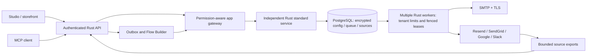

# Rust standard services and language boundaries

VEYNDO's commerce server and bundled Email Delivery / Google Analytics / Gmail / Slack
service run in Rust. The connector is a separate process (`cargo build --locked --bin
connectors`), not provider logic embedded in checkout handlers. Both services use
PostgreSQL; connector private records are encrypted with AES-256-GCM, bound to tenant
and app, and protected by forced RLS. The shared gateway alone supplies tenant identity.
The public UI never receives gateway/provider keys. Run an ordinary database role with
`NOSUPERUSER NOBYPASSRLS` and `DB_RLS_REQUIRED=true`; startup then rejects table ownership,
owner membership, TRUNCATE privilege and unprotected connector tables. Database administrators
still hold trusted system authority. Local development can use the schema owner with this
strict switch disabled; that is not a production RLS configuration.

## Independent App Runtime

The [App Runtime service](app-runtime-service.md) is a separate Rust process in
`veyndo/apps/service`, mirrored by exact source into
`extensions/services/app-storage/service/`. It exposes authenticated HTTP/OpenAPI
and stateless MCP, with Fetch and existing SDK examples. It uses the same bounded
WIT engine without Core, SQL, a live resolver or provider execution. Current access
comes from a fixed external OAuth introspection owner; no user/role store or key
issuer is introduced. Its non-root runtime image contains no Python or compiler.
[Runtime service acceptance](evidence/app-runtime-service-component-2026-11-06.md).

## Modules and ownership

| Module | Responsibility |
|---|---|
| `src/bin/connectors.rs` | Process entry only; calls the `veyndo-connectors` service crate (`extensions/services/connectors`), which composes the `veyndo-connector-runtime` crate and one `veyndo-provider-<app>` crate per bundled app |
| `extensions/services/connectors/src/server.rs` | HTTP authentication, OAuth completion, size limits, graceful shutdown |
| Host `actions.rs`, app `extensions/apps/email/src/email.rs` | Existing app actions, events and exports; unchanged API/MCP/flow contracts |
| `extensions/apps/email/src/{config,templates}.rs` | Rust setting types, runtime validation, bounded multilingual templates |
| Runtime `crypto.rs`, `store.rs` (`extensions/services/connector-runtime/src/`) | Authenticated encryption and transaction-local RLS/configuration context |
| Runtime `queue.rs`, service `worker.rs` | PostgreSQL idempotency, tenant admission, fair claims, leases and outcome handling |
| App `extensions/apps/email/src/smtp.rs`, runtime `network.rs` | Pinned SMTP addresses, verified TLS, fixed HTTP endpoints, bounded responses |
| Runtime `oauth.rs`, app `extensions/apps/<app>/src/actions.rs` | Shared single-use state/token fencing over the policy the app declares; app-owned OAuth scope, protocol and field admission |
| `extensions/apps/{gmail,google-analytics,slack}/src/`, runtime `exports.rs` | Gmail incremental cursors, exact GA4 rows, Slack notification and bounded exports |
| `extensions/services/connectors/migrations/0001-baseline.sql` | Six private tenant-scoped tables and forced RLS, applied by the commerce setup in the global baseline order |

## Distributed queue semantics

A new tenant/request key and payload fingerprint are committed atomically. Reusing the
key with changed input is rejected. PostgreSQL tenant limit rows serialize daily quota
and concurrent admission. Claims use `FOR UPDATE SKIP LOCKED`; a UUID lease fences all
completion writes. A worker may finish only its current, unexpired lease.

Defaults **per tenant/app**: 10,000 new jobs/day, 1,000 waiting/running jobs, 120 dispatches
per minute, two running jobs. Set `CONNECTOR_TENANT_DAILY`, `CONNECTOR_TENANT_BACKLOG`,
`CONNECTOR_TENANT_PER_MINUTE`, `CONNECTOR_TENANT_CONCURRENCY` consistently on every
instance. Defaults are protective configuration, not measured throughput claims.
`CONNECTOR_WORKERS_PER_APP` defaults to two and accepts 1–8 per process. Scale processes
against one PostgreSQL database; preserve the same encryption and gateway keys.

Leases last 120 seconds; operations have a 60-second ceiling and mail provider calls
an 8-second ceiling. Starting another process does not steal active leases. Only expired
leases become `uncertain`. A retry is permitted after an explicit HTTP 429 rejection,
bounded to eight attempts. A timeout, lost connection or ambiguous notification-provider
failure is **not** automatically resent. Provider acceptance does not prove inbox delivery.
Stable SMTP Message-ID and Resend idempotency improve reconciliation; SMTP and SendGrid
cannot provide universal exactly-once delivery. Inspect provider records for uncertain jobs.

Email configuration changes serialize with provider dispatch. Pending jobs carry their
saved configuration revision and fail after an intervening change/disable. Credentials
are write-only and encrypted; provider/SMTP identity changes clear stale credentials.
An accepted external mail cannot be recalled. The service drains active work on shutdown.

## Deployment

1. Run the commerce setup (`BOOTSTRAP_MODE=migrate`) before starting the connector; it refuses to
   start until the ledger records `connectors/0001-baseline`.
2. Set `CONNECTOR_DATABASE_URL` (or `DATABASE_URL`), `CONNECTOR_SECRET_KEY` (32-byte URL-safe
   Base64), `CONNECTOR_GATEWAY_TOKEN` and `CONNECTOR_PUBLIC_URL`.
3. Keep the existing `APP_SERVICES` mappings and OAuth callback URLs. The Compose
   `connected-apps` profile now builds a Rust-only image with PostgreSQL persistence.
4. Back up the database **and** encryption key. `/health` checks database reachability
   without exposing tokens, configuration or customer content.

For production, provision a dedicated connector login (no superuser/bypass/owner
membership). Grant schema usage; SELECT on `commerce_migrations`;
SELECT/INSERT/UPDATE/DELETE on the six `connector_*` tables; and USAGE/SELECT/UPDATE
on `connector_changes_seq_seq`. Set its URL as `CONNECTOR_DATABASE_URL` and enable
`DB_RLS_REQUIRED=true`. Trusted workers still use transaction-local system scope;
ordinary tenant actions use tenant scope. The gateway key is therefore server-only authority.
The connector does not read Core identity tables or receive the Core scope signer.
The native gateway checks the live shop before dispatch; existing foreign keys
reject writes for missing shops. Remove obsolete `SELECT ON tenants` grants when
upgrading the connector before activating authenticated Core SQL scopes.

### Private hosted networking

The [Connector component guide](connector-component.md) covers both the Core
profile and the independent database profile. The latter uses registered shop
namespaces and scoped access. Keep the Core profile when changing only the
image for an existing service.

For Northflank, keep connector port 8797 private and configure the core with
`APP_SERVICE_PRIVATE_ORIGINS=http://veyndo-connectors:8797`. Each operator-owned
`APP_SERVICES` entry then uses `http://veyndo-connectors:8797/APP_ID` and the shared
gateway token. The allowance matches the exact origin, including its port; it does
not permit arbitrary HTTP endpoints, URL credentials, query strings or fragments.
The shared HTTP client disables redirects. HTTPS remains the default outside this
explicitly trusted private network. Keep database TLS enabled independently.

Northflank's runtime encryption key must use **padded** URL-safe Base64 encoding
(44 characters for 32 bytes), as required by the connector's decoder. Inject it as
a runtime variable, not a build argument or an unparsed `.env` file. Email credentials
are configured through the app's `configure` action and encrypted in PostgreSQL.
Configure test mode first; changing hosting does not authorize sending test emails.

There is no import of state from the earlier SQLite/Python connector worker: a release
replaces earlier installations, and connector configuration is entered again through each
app's `configure` action.

## Why Python still exists in the repository

| Python scope | Decision |
|---|---|
| Former bundled connector | Ported completely to Rust; archived in `reference/connectors-python/` for differential fixtures, never copied into its runtime image |
| Verification, source/coverage checks, documentation generation | Keep as development/CI tools; no request processing or provider delivery |
| `scripts/connectors.py` | Local lifecycle tool; it launches the compiled Rust service |
| `scripts/mcp_stdio.py` | Optional client-side JSON-RPC bridge; hosted `/mcp` runs in Rust |
| Product Lab / service-example | Explicit independent third-party-style app examples demonstrating language-independent extensions; not a commerce runtime dependency |
| Private Storyfront/Experience apps | Separate repositories and product boundary; not imported into the public core |

Removing all Python tooling would not make API latency lower. The architectural rule is:
**first-party central runtime in Rust; protocol-based external apps language-independent;
verification tools outside production serving**. Any future bundled provider service must
follow the Rust rule and use the documented gateway, tenant ownership and durable queue.

## Schema baselines

`BOOTSTRAP_MODE=migrate` (or `auto`) runs `src/migrations.rs`, which applies the files
listed in `src/migrations/schema.rs` that the ledger does not record yet, under the setup
advisory lock, and records `<component>/<file>` with the file's SHA-256 in
`commerce_migrations`. A fresh installation applies the baselines below and then every
forward migration; a production database applies only the forward migrations it lacks
([Forward migrations](#forward-migrations)):

| Order | File | Contents |
| --- | --- | --- |
| 1 | `components/core/migrations/0000-foundation.sql` | `pg_trgm`/`pgcrypto`, the `veyndo_authority` schema with its per-database random scope key, the signed-scope functions (verbatim section shared with the app-storage host), and the trigger, history and scope functions used by several components |
| 2 | `components/core/migrations/0001-baseline.sql` | Tenants, outbox, checkpoints, leases and read-context versions, with the two built-in shops |
| 3 | `extensions/services/connectors/migrations/0001-baseline.sql` | The six `connector_*` tables |
| 4… | `components/<name>/migrations/0001-baseline.sql` | identity, pricing, catalog, inventory, shop, b2b, marketing, customers, orders, payments, checkout, intelligence, apps, studio |

The order is core first, then dependencies before their users (`components.json` `uses`,
ties by name); `scripts/components.py` refuses a list in another order or a file that
creates another component's table. Each baseline holds its tables, sequences and
functions, the rows a fresh installation starts with, then its constraints, indexes,
triggers, row security and grants. A foreign key or policy that references a later
component's table is created in that later component's file.

Readiness (`ready`) requires every migration the binary ships, recorded with the shipped
checksum; migrations a newer release recorded do not stop an older binary from serving
(expand/contract keeps them compatible). Setup refuses a database whose ledger records the
pre-baseline incremental release (`001`): there is no upgrade path from it. The demo data
runs after the schema from `fixtures/demo/*.sql` and the Rust seed, marked `demo-v1` in the
same ledger.

The registered `schema_baseline` suite sets up a new database with the built binary and
compares a normalized `pg_dump --schema-only` (every statement, sorted, owners left out)
and the starting rows with `fixtures/schema/reference.sql`, the schema of "baselines + all
forward migrations". The baselines were proven equal to the last release with incremental
migrations (commit `ce4285d7`) when they were introduced; every forward migration since
regenerates the reference with `python3 scripts/schema_baseline.py --write`, so the diff
shows up in review. The `schema_upgrade` suite proves the same schema is reached by
upgrading a database that the previous release installed (see below).

Older guides, audits and the changelog name the incremental migrations 001–113 of
earlier releases (for example "migration 099"). Their schema is contained in the
owning component's baseline; the numbered files no longer exist.

## Forward migrations

Production went live on 27 November 2026 from the baselines and holds real data. Every
schema change since is a forward migration that upgrades the live database:

- **File and number.** `components/<name>/migrations/NNNN-lowercase-words.sql` in the
  component that owns the changed tables (`0002` after the baseline, no gaps or
  duplicates within a component). `src/migrations/schema.rs` lists every file ordered by
  number, then by the global component order; `scripts/components.py` refuses another
  order, a numbering gap, a badly named file and a forward migration that creates,
  alters, drops, indexes, triggers, writes or adds a policy to another component's table.
- **Ledger.** Each migration is recorded as `<component>/<file stem>` with its SHA-256.
  An applied file that changed is refused ("restore it and add a new migration"). A
  pending migration that sorts before an applied one is refused too: a database must
  apply migrations in the same order as a fresh installation, so a new file needs a
  number above every migration already in production (two components may share a
  number in one release). One session-level advisory lock serializes concurrent setups.
- **Transactions.** A migration runs in one transaction with its ledger row. A file whose
  first line is `-- veyndo:no-transaction` runs as steps separated by `-- veyndo:step`
  lines, each committed on its own (a batched backfill `DO` block may `COMMIT` between
  batches; `CREATE INDEX CONCURRENTLY` needs its own step). Its ledger row is written after
  the last step, so every step must be safe to run again after an interrupted setup
  (`IF NOT EXISTS`, backfills that only touch unconverted rows).
- **Expand/contract.** The release workflow migrates (`vendune-migrate`) while the previous
  release still serves, and both releases serve together during a rolling deploy. A
  migration therefore only expands: add nullable or defaulted columns, new tables and
  indexes, triggers that keep an old and a new representation in step, and backfills in
  bounded batches. Constraints on new columns (`NOT NULL`, `CHECK`, foreign keys), dropping
  or renaming columns, tightening types and removing compatibility triggers belong to a
  later release, once no binary that needs the old shape serves. Never rename or retype a
  column the previous release reads.
- **Proof.** `schema_upgrade` builds the previous release (the commit before the newest
  migration file) in a temporary worktree under `target/`, installs it fresh, writes a
  shop, products, a cart, an order and a payment through its HTTP API, migrates with the
  new binary, checks the data and the new behaviour, compares the upgraded schema with
  `fixtures/schema/reference.sql` and serves one request round from the old and the new
  binary at the same time against the migrated database.

### First forward migration: exact product prices

`catalog/0002-exact-product-prices` (no-transaction: expand step, then a backfill of 500
rows per committed batch) adds `numeric` columns `price_decimal`, `tax_rate_decimal`,
`list_price_decimal` and `regulation_price_decimal` beside the baseline's `double
precision` columns. The type is `numeric` without a fixed scale: a product price is the
decimal the merchant entered in the shop's main currency, which the quote rounds to that
currency's minor unit (`Ratio::rounded`, `Minor`) only when it prices a line. A fixed
`numeric(20, e)` or integer minor units would need one currency exponent per column,
but shops differ (JPY 0, EUR 2, KWD 3), may change their main currency and may enter
more digits than the exponent; `numeric` maps one to one onto `Decimal` (units and scale).

The trigger `exact_prices_sync` keeps both representations in step while the previous
release serves: a write of an exact column sets the binary64 column to the nearest
double, a write of only the binary64 column sets the exact one to its shortest decimal
(the digits `Decimal::from_wire` reads). The release reads and writes only the exact
columns through `veyndo_catalog::store::exact::Exact` (binary `numeric` codec, no new
crate feature); JSON still carries the same numbers. The contract step for a later
release: `NOT NULL` and `>= 0` on the exact columns, then drop the trigger, its function
and the four binary64 columns (test fixtures that still insert `price`/`tax_rate`, such
as the vendored marketplaces tests, must move first).

## Typed inputs and checked queries

- Component and server functions read JSON inputs and stored documents through typed views
  (`veyndo_core::document::{view, lenient, Raw, merge}`): a lenient field reads exactly what
  the JSON accessor read for every shape, proven once in `components/core/src/document.rs`.
  `scripts/testing/typed_inputs.py` (part of `scripts/structure.py`) refuses a new untyped
  read of a JSON parameter; the remaining readers are listed by category in
  `scripts/testing/typed-inputs.json` and the list only shrinks.
- Store reads written as `sqlx::query_as!` are checked at compile time from the committed
  `.sqlx` cache (`.cargo/config.toml` sets `SQLX_OFFLINE`, so no build depends on a live
  database). After adding or changing such a query run `scripts/sqlx_cache.py --write`; it
  sets up a scratch database from the component baselines and regenerates the cache. The
  `sql_prepare` suite runs `--check` and fails when the cache no longer matches that schema. Every other
  static statement is still prepared against the schema by `scripts/sql_prepare.py`.

## Verification and remaining limits

- Rust parser/template/encryption tests include wrong tenant/app binding, tampering,
  header injection, invalid types and localized rendering.
- `scripts/rust_connectors.py` starts two real Rust services against PostgreSQL and local
  provider fixtures: raced idempotency, quotas, leases, ambiguity, OAuth callbacks,
  Gmail/GA4/Slack, knowledge/MCP ingestion, bounded source exports and non-owner/non-bypass
  service instances, plus strict unsafe-role rejection and noisy-neighbor admission.
- `scripts/email_tests.py` compares against the archived Python implementation and uses the actual
  Rust checkout → outbox → Flow Builder → Rust service → SMTP path, including consumer receipts.
- SMTP STARTTLS/TLS, HTTP wire formats and stale configuration are tested against synthetic fixtures. No real account, payment or external message is used.
- Lean covers the exact notification retry predicate only; SQL, TLS and provider protocols
  remain tested, unproved adapters. Passing tests does not mean full-system 100% coverage.

No bounce/delivery webhooks, attachments, campaign/suppression system, rotating Slack
bot tokens, unrestricted mailbox backfill or measured provider throughput are claimed.

## Runtime hardening owners

- `components/core/src/request_context.rs`, `components/identity/src/route_policy.rs`, `src/auth/identity.rs`, `components/identity/src/http/abuse.rs`, `components/identity/src/types/envelopes.rs` and `components/identity/src/store/identity.sql`: trusted Principal, explicit method rights, one current grant lookup, persistent login admission and typed auth requests.
- `crates/runtime/src/scoped_pool.rs`, `components/core/src/store/{pool,row_security,lease}.rs`, `src/runtime_config.rs`: local transaction scope, guarded session borrows, validated startup contracts and shared resource/connection budgets.
- `components/apps/src/service/{sandbox_cache,business_policy}.rs`, `extensions/apps/marketplaces/service/runtime.rs`, `crates/cognition/src/images.rs`: bounded Wasm compilation/execution cache and blocking-pool image processing.
- `components/core/src/work_signal.rs`, `src/outbox.rs`, `src/outbox/retention.rs`, `components/core/src/store/outbox_control.rs`, `retention.sql` and the core baseline: commit hints, isolated retries/quarantine, permission-checked recovery and bounded retention.
- `deploy/sql/provision-runtime.sh`, `scripts/security/core_hardening.py`, `scripts/testing/pooler.py`, `scripts/transaction_pooler.py`: least-privilege provisioning and actual two-replica/one-backend PgBouncer regression paths.

[Security boundaries](security.md).

## Related services

| Service | Guide |
| --- | --- |
| EDI parsing and export (`extensions/apps/edi/`) | [EDI](edi.md), [B2B commerce](b2b-commerce.md) |
| Marketplace gateway (`marketplace-gateway`, `extensions/apps/marketplaces/`) | [Marketplace channels](marketplaces.md) |
| UCP B2B negotiation (`src/ucp/`) | [B2B negotiations through UCP](b2b-ucp-negotiation.md) |
| Vercel, Klaviyo, HubSpot, Contentful and Algolia packages on the connector host (`extensions/services/connectors/src/integrations/`) | [Service integrations](service-integrations.md) |
| App Data reader, writes, job supervision, package installation and settings (`extensions/services/app-storage/`) | [Reads](app-data-service.md), [writes](app-data-writes.md), [jobs](app-job-supervision-service.md), [installation](app-package-installation-service.md), [settings](app-settings-service.md) |
