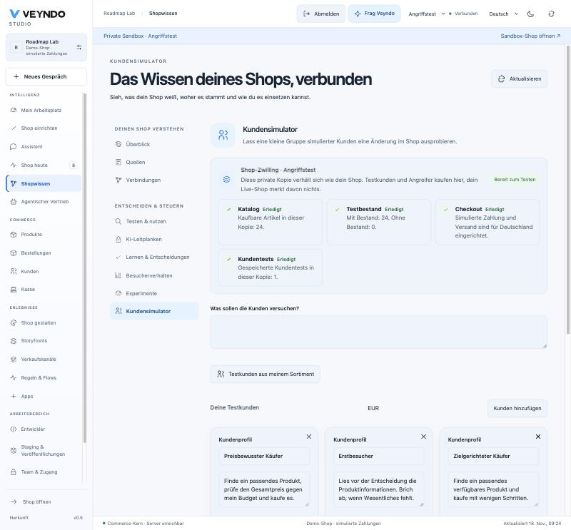
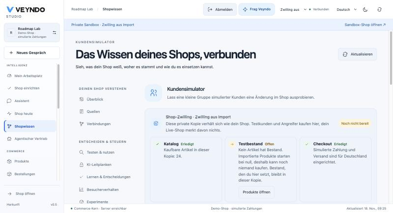

# Test a twin of your existing shop

A shop twin is a private copy that behaves like your shop: same catalog, prices,
rules, taxes, shipping and checkout. Fictional customers and scripted attackers
buy in the copy. Your live shop, its stock and its customers are not involved,
and you do not have to migrate anything first.

*Local Studio, synthetic shop, 18 November 2026.*

## Build the twin

1. Open **Staging & releases** and create a **private sandbox**. This is the twin.
2. Bring your catalog into it. Choose the path that fits your current shop:

   | Your shop today | Path | Guide |
   | --- | --- | --- |
   | Shopify | Upload the product export CSV | [Shop imports](agentic-commerce.md) |
   | Shopware 6, WooCommerce, PrestaShop | Migration Assistant with the twin as private target | [Bring an existing shop](agentic-migration.md) |
   | Anything with a spreadsheet | Generic CSV with name, description, price, product number, image | [Shop imports](agentic-commerce.md) |
   | Already on Veyndo | Nothing to import; the sandbox starts as a copy of your shop | [Sandboxes](workbench.md) |

3. Open **Shop knowledge → Customer simulator** with the sandbox selected. The
   **Shop twin** panel shows four steps and what is still missing.

## Read the four steps

| Step | Done when | If it is open |
| --- | --- | --- |
| **Catalog** | The copy has purchasable items and the selected sales channel shows them | **Bring catalog** opens the import |
| **Test stock** | At least one item has stock | **Open products** and set stock; it stays in the copy |
| **Checkout** | A simulated payment method and a shipping method are active for the first delivery country | **Open settings** |
| **Customer tests** | You saved at least one customer test in this copy | Describe a goal below the panel and start |

Imported products start with **zero stock**. That is deliberate: Veyndo does not
invent inventory. The twin therefore says "No item has stock" instead of letting
every test customer fail at checkout. Stock you set in a sandbox is never
published to the live shop.

## Test the twin

- **Fictional customers** try a goal you describe and place simulated orders.
  [Customer simulator](customer-scenarios.md).
- **Scripted attackers** try to cheat cart and checkout.
  [Attack test](customer-scenarios.md#attack-test).
- **Recorded orders** show what a changed rule would have done.
  [Rule comparison](rule-history-comparison.md).

## What the twin is not

- It does not copy customers, orders or payment credentials from your current shop.
- It is not kept in sync with the source. Import again to refresh it.
- Fictional customers are test instructions, not a forecast of real conversion.
- Readiness checks the first delivery country and a sample of up to twelve items
  in the selected sales channel, not every country and product.

## Operation

`merchant.scenario.readiness` (`GET /api/agent/scenario-readiness`) returns the
figures of the panel for the selected private sandbox. It is read-only, needs the
same rights as the customer simulator and refuses live shops. MCP exposes the
same operation.
