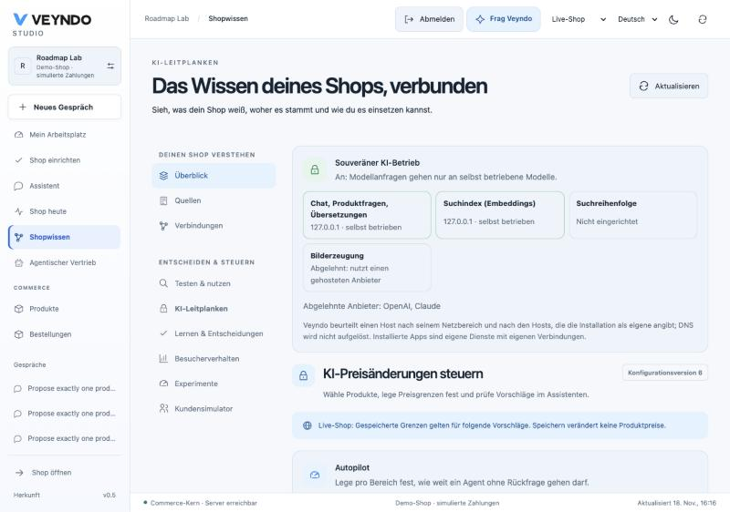

# Sovereign AI mode

One switch for the whole installation: Veyndo then sends model requests only to
models you operate yourself. OpenAI and Claude are refused for every shop, and
so is image generation, which uses a hosted provider. Each shop sees in Studio
which host every model route uses.

*Local Studio, synthetic shop, local Ollama model, 18 November 2026.*

## Who switches it on

The mode belongs to the person who operates the installation, not to a single
shop. There are two ways:

| Way | Where | Can it be switched off in the console? |
| --- | --- | --- |
| Operator setting | Platform console → **AI providers** → **Sovereign AI mode** | Yes, by the operator |
| Deployment variable | `SOVEREIGN_AI=true` on the commerce service | No. The console shows it as fixed |

Use the variable when the mode is a contractual requirement and must not depend
on a setting.

## What counts as self-hosted

Veyndo cannot know who owns a server. It accepts a model endpoint when its
host is one of these:

- loopback (`localhost`, `127.0.0.1`, `::1`)
- a private network address (`10.x`, `172.16`–`172.31`, `192.168.x`, IPv6 `fc00::/7`)
- a name without a dot, or one ending in `.internal`, `.local`, `.svc` or
  `.localhost`, as used inside a cluster or a private network
- a host you list in `SOVEREIGN_MODEL_HOSTS` (comma-separated), for a model
  server you operate under a public name, for example
  `SOVEREIGN_MODEL_HOSTS=models.example.com`

Every other host is treated as external. **Veyndo does not resolve DNS**: an
internal-looking name that points to an outside address is not detected. Keep
outbound network rules in place if you need that guarantee.

## What the mode does

| Model route | With the mode on |
| --- | --- |
| Chat, product questions, translations, app generation | Only the local route (Ollama protocol); its endpoint must be self-hosted |
| OpenAI, Claude | Refused before a request is built; shown as unavailable in Studio |
| Search index (embeddings), `EMBEDDING_BASE_URL` | Must be self-hosted, otherwise indexing stops with an error |
| Search ranking, `RERANKER_URL` | Must be self-hosted, otherwise results keep their order without reranking |
| Image generation | Refused |

Saving the switch is refused when the text, embedding or reranker endpoint is
not self-hosted, so you cannot switch into a mode that would refuse every call.
A change reaches every running replica within five seconds.

## Check it in Studio

Open **Shop knowledge → AI guardrails**. The card **Sovereign AI mode** shows
whether the mode is on and, per route, the host and whether it is self-hosted.
The card only reads; it shows host names, never keys or full addresses.

## What it does not cover

- Apps you install are separate services with their own connections. The mode
  does not control them.
- Payment, shipping, email and marketplace providers are not model calls and
  are unaffected.
- It is not a network firewall and not a certification of data residency.
