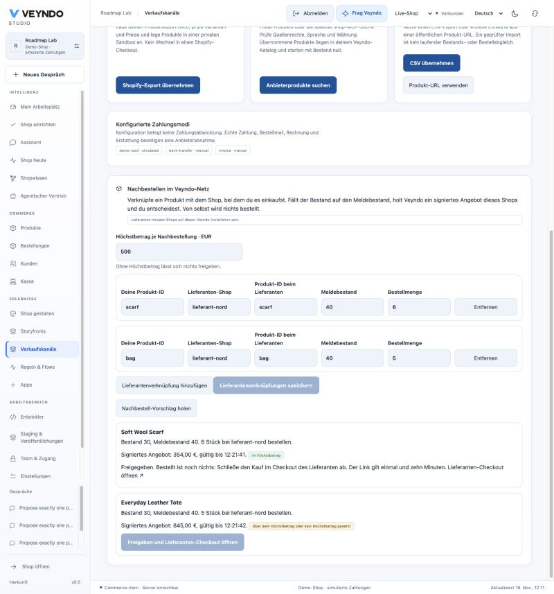

# Reorder from other Veyndo shops

Your shop can buy from another shop on the same Veyndo installation the way an
agent would: it asks that shop's public checkout for a signed offer, checks it
against a ceiling you set, and shows you the proposal. You approve, and Veyndo
opens the supplier's checkout with the basket ready. **Nothing is ordered by
itself.**

*Local Studio, two synthetic shops, 18 November 2026.*

## Set it up

1. Open **Sales channels → AI channels & imports** and scroll to **Reorder in
   the Veyndo network**.
2. Enter the **ceiling per reorder** in your shop currency. Without a ceiling
   nothing can be approved.
3. Choose **Add supplier link** and fill in:

   | Field | Meaning |
   | --- | --- |
   | Your product ID | The product in your shop |
   | Supplier shop | The shop identifier of the supplier on this installation |
   | Product ID at the supplier | The product you buy there |
   | Reorder point | A proposal is made when your stock is at or below this |
   | Reorder quantity | How many to buy, 1 to 1000 |

4. Choose **Save supplier links**. They are part of the shop settings, with
   their revision and sandbox review.

## Get a proposal and approve it

1. Choose **Get reorder proposal**. For every linked product at or below its
   reorder point, Veyndo creates a guest basket at the supplier shop and fetches
   a [signed offer](agentic-commerce.md#signed-offers).
2. Read each line: your stock, the quantity, the supplier's total and until when
   the offer is valid. The line says whether it is within the ceiling, whether
   the supplier quotes in another currency and whether the supplier currently
   shows less stock than you want.
3. Choose **Approve and open supplier checkout** on a line within the ceiling.
   Veyndo checks the offer again and gives you a link to the supplier's own
   checkout. The link works once and for ten minutes.
4. Complete the purchase there as a customer of that shop: address, payment and
   order confirmation belong to the supplier's checkout.

## What crosses the shop boundary

Your shop acts at the supplier as an ordinary guest. It uses only what any
visitor can use: basket, quote and checkout handoff. No merchant right, customer
data or stock figure of your shop is sent, and the supplier does not have to
agree to anything beforehand. A paused or private supplier channel refuses the
basket, and the line shows the supplier's answer.

## Limits

- **Same installation only.** A supplier on another Veyndo host, or on another
  shop system, is not supported yet.
- **No automatic order, no purchase order record.** Approval records an event
  (`supply.reorder.approved`) and opens the checkout; the order exists only once
  you complete it there, and your stock is not increased by it.
- **Guest prices.** The offer is the supplier's public price. Company accounts,
  negotiated B2B prices and quotes are not used.
- **One product per offer**, at most 50 links per proposal and 200 links in total.
- The ceiling applies to each reorder, not to a day or a month.

## Operations

| HTTP | Right | Purpose |
| --- | --- | --- |
| `POST /api/merchant/supply/proposal` | `settings.read`, `catalog.read` | Fetch signed supplier offers for products at or below their reorder point |
| `POST /api/merchant/supply/approve` | `settings.write`, `catalog.read` | Re-check one offer against the saved link and ceiling and return the supplier checkout link |

These two operations are not exposed as MCP tools yet.
